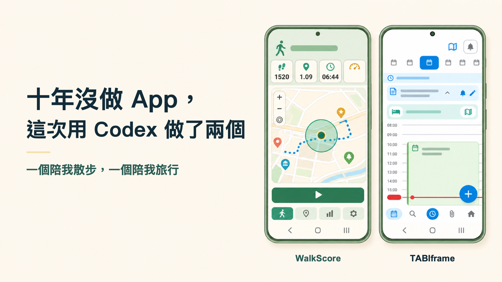
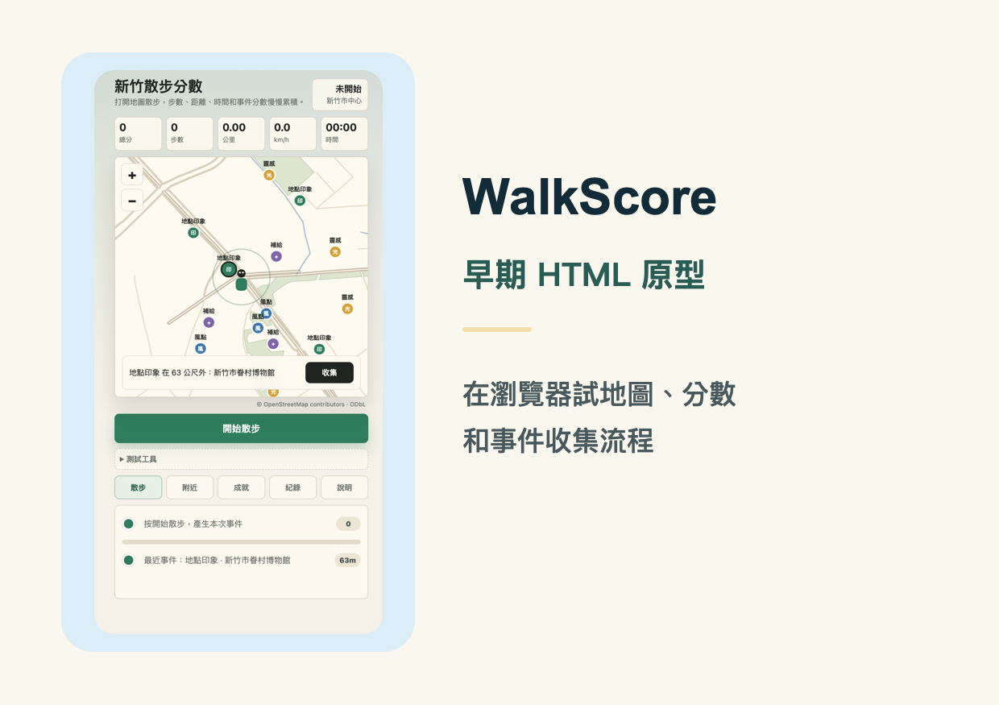
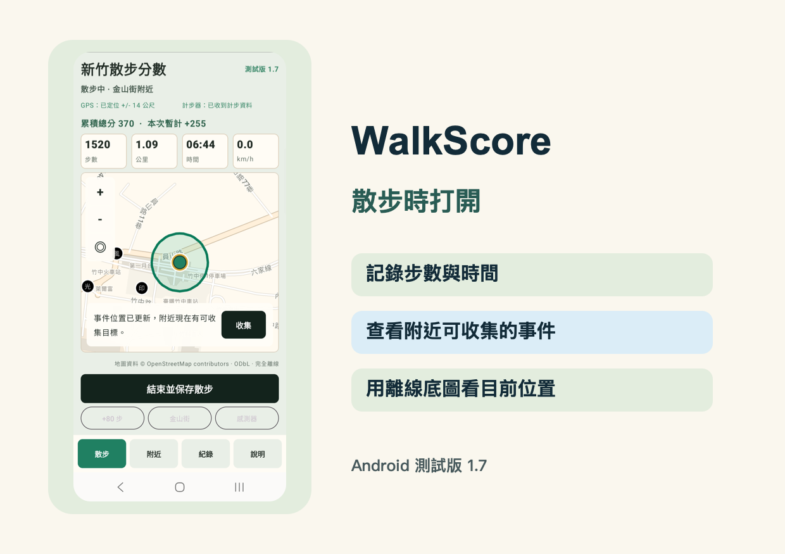
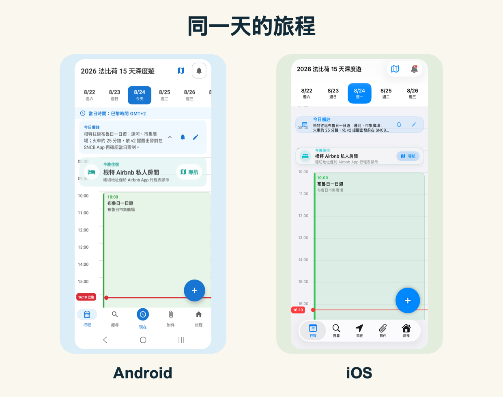

# [程式] 十年沒做 App，這次用 Codex 做了兩個

十年前自己做 App，光是排版畫面、搭環境、對版本與學 Java 就要忙上很久；這次我一行程式碼都沒看，用平常講話的方式跟 AI 溝通，就用 Codex 做出兩個自己天天用的 App。一個陪我散步，一個陪我旅行。

<!--more-->

我用 Codex 做了兩個自己會用的 App：

- **WalkScore** 陪我散步。出門時可以離線記步、累積分數，還能在地圖上看到自己走過的路。
- **TABIframe** 陪我旅行。行程、住宿和票券放在一起，同一份旅程檔在 Android 和 iOS 都能開。

---

## 十年前，光是排畫面就要忙很久

我上一次自己弄 Android App，大概是十年前。我記得光是弄畫面就有很多事：這一頁要放什麼？按了要跳去哪裡？頁面要怎麼切換？這些都得自己排。還要搭環境、對版本、學 Java，再一行一行把程式寫出來。

這次我先把開發環境和專案資料夾準備好，接著用平常講話的方式告訴 Codex 我想做什麼。畫面、按鈕和頁面切換，它就能先做一版給我試。後來才回頭看，兩個 Android App 用的是 Kotlin，TABIframe 的 iOS 版用的是 Swift。我做的時候想的是：打開 App 之後，能不能做我想做的事。

---

## WalkScore｜先在瀏覽器試，再帶出門散步

我一開始只想做個有點像皮克敏的東西。出門走路，靠近地圖上的東西就可以加分，而且我想離線用。玩法還沒想清楚，我就問 Codex：「是不是可以先做一個 HTML 的樣子來當樣板呢？」

它先做了個網頁，我在瀏覽器點點看。看到地圖、分數和事件出現在同一個畫面，我才比較知道自己想要什麼。

*早期 HTML 原型。這時就能先試地圖上的事件和收集流程。*

後來我用 Macbook Air 開發，把 Android 版直接裝到自己的 S24。真的帶出門走了一趟，才想到幾件事：

- **螢幕要一直亮著。** 我散步時只是想低頭看一眼，不想每次都把螢幕叫醒。
- **站著的時候，步數不要增加。** 我當時問「我沒有移動，被當作移動？」後來步數改用手機的計步器，定位則用來記錄走過的路。
- **附近的事件可以多一點。** 我請 Codex 先加一個滑桿，讓我邊走邊試，再把適合的數量定下來。
- **走過的路想看得見。** 散步當下想看藍色足跡，結束之後也想從紀錄回看。

看到自己走過的路真的畫在地圖上，那個感覺蠻棒的。新竹底圖用的是 **OpenStreetMap** 圖資，打包成 **PMTiles** 放在 App 裡，再用 **MapLibre** 顯示。手機開著定位，就算沒上網也能看底圖和足跡。

這些功能有些是第一版出來後才想到的。我當時就是想到一個、試一個，有用就留下來。

---

## TABIframe｜Android 做好之後，再做 iOS

做旅行 App 時，我手上已經有一份行程和 App 規格。我把它們和專案資料夾交給 Codex，先說「請先說明你的理解，還不要開始，可以提問」。看過它的理解，覺得方向對了，我才請它一口氣做出第一版。

有些細節還是要拿手機才知道。像我想往下看晚一點的行程，手指碰到色塊卻把事件拖走了。我試過長按兩秒、一秒，最後改成半秒才可以拖，放手後再確認。這種手感要真的滑過才講得清楚。

後來想做 iOS，我先開好 Xcode 專案，再請 Codex 參考已經用過的 Android 版。我交代兩件事：

- **功能帶過去，操作照 iOS 的習慣。**
- **兩邊都能匯入同一份檔案。** 支援匯入 `.tabiframe` 檔，先把這趟旅程匯出保存，下次換一份資料匯進去，就能繼續用原本的 App。

這就是我想做的旅行框架。去下一個地方，換旅程檔就好，程式不用重新編譯。行程、住宿和票券也能一起帶過去。

<a href="InteractiveShowcase/" target="_blank" rel="noopener noreferrer">👉 點此進入 TABIframe 互動展示（開新頁面）</a>

*同一天的旅程。左邊是 Android，右邊是 iOS。*

我只想裝在自己的裝置上用，兩邊都可以先裝來試， **不用上架** 。實際裝起來有個差別：

- **Android** ：我在 S24 開啟開發者模式和 USB 偵錯，接上 Mac 就可以裝。我還能看著 Codex 操作手機。
- **iOS** ：用免費 Apple 帳號也可以透過 Xcode 裝到自己的裝置。安裝用的描述檔七天會到期，到時要重新編譯、安裝。Apple Developer Program 的年費是 99 美元。[Apple 免費帳號的真機測試規則](https://developer.apple.com/help/account/basics/about-your-developer-account) · [Apple Developer Program 年費](https://developer.apple.com/help/account/membership/program-enrollment)

---

## 我這次怎麼用 Codex

- **前期規劃和產圖，我常放在 ChatGPT。** 我先在那邊想功能、看畫面範例，方向差不多了，再用 Codex 動手開發和測試。以我當時的用法，這樣可以把 Codex 的額度留給開發。
- **沒有五小時額度的那段時間，用起來很舒服。** 後來限制加回來，有一次我半天就用掉了粗估相當於六個五小時額度的量。那陣子我開了高階選項和加速，也常碰到重置。有重置券的時候，我會自己決定什麼時候用。
- **同一個對話接著做，也能把專案做完。** TABIframe 大多在同一個對話裡從 Android 做到 iOS，對話長到壓縮了好幾次。我沒有特別留每輪的文件，平常也很少回頭看。到了想寫這篇文章，才想找出當初自己怎麼提需求、用過後為什麼改。

---

## 如果朋友問我「不會寫程式，也能做嗎？」

我會說，可以先這樣做：

1. **把需求講清楚。** 你會在什麼時候打開這個 App？打開之後，最想完成哪一件事？
2. **先請 AI 做幾個範例。** 看一下畫面，也點點看。感覺對了，就請它一口氣做出一版能用的。
3. **裝到自己的手機，真的用一次。** 哪裡卡住，或是用著用著想到還想加什麼，就接著講。

我一開始只是想讓散步有點分數可以累積。想看足跡、想回顧散步紀錄，都是帶著手機走出去才想到的。 **先把最想要的功能做出來，其他的可以邊用邊加。**

---

## 我的連結
- Youtube: https://www.youtube.com/@Daydream-Studio/videos
- Podcast: https://cl4bfh8ww02uu01zgaj2i3d1u.firstory.cc/episodes
- FaceBook: https://www.facebook.com/profile.php?id=100082389794254
- Blog: https://nostanduptalk.github.io/

