# [旅遊] 2026歐洲15天 [EP1 行前準備] 15天打包清單與預算開銷 | 歐洲自由行 | 實體SIM卡預約開卡 | 歐洲預算 | 洗衣機烘衣機 | 法比荷三國文化 | 歐洲生存

規劃一趟 15 天橫跨法國、比利時、荷蘭的歐洲自由行，行前準備往往是決定旅程舒適度的關鍵。本篇整理了 15 天僅帶 5 套衣物的極簡打包策略、總開銷 13 萬元的預算花費拆解、實體 SIM 卡開卡避坑要點，以及實際走訪法比荷三國時觀察到的硬體設施與生活文化，帶你一次掌握歐洲自由行的生存秘笈！
<!--more-->

## 一、 輕量化打包與裝備策略

長天數的歐洲跨國旅行，如果每天拖著笨重的行李箱上下火車石子路，體力很快就會被消耗殆盡。「輕量化」是讓旅行保持彈性與優雅的核心原則。

### 1. 5 套衣物極簡打包法

- **以少勝多** ：15 天旅程全程僅攜帶 **5 套換洗衣物** ，透過定期使用當地的投幣式洗烘衣機維持循環。
- **洗烘衣機實戰眉角** ：
  - 操作時通常需先在中央控制面板選擇對應的機號後再付款。
  - 付費方式需特別注意，部分傳統洗衣店需要自備硬幣，而許多新式洗烘衣機則已全面轉為感應刷卡。
  - 烘衣時請留意設定溫度，避免我選到太低溫結果沒乾。

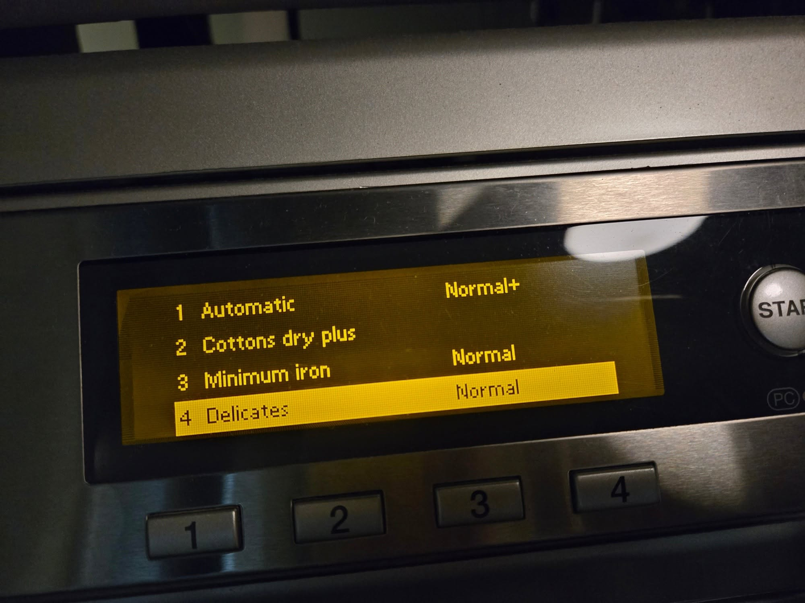

- **隨身防延誤備案** ：隨身背包內務必額外預備 **1 套換洗內衣褲與基礎旅行盥洗包** ，萬一托運行李不幸延誤或遺失，抵達的第一晚依然能維持基本生活品質。

### 2. 神裝備與避坑清單

- **必備神級裝備** ：
  - **Uniqlo 半月包** ：容量彈性且貼合身軀，拉鍊向前背負極具安全感。
  - **手機防盜掛繩** ：在歐洲使用手機感應支付頻率極高，掛繩不僅防手滑摔機，更是防範街頭扒手順手牽羊的防禦神物。
  - **個人常備藥品** ：歐洲就醫與購買成藥手續較繁瑣，感冒藥、止痛藥、腸胃藥必須備妥。
  - **配件與雜物** ：墨鏡、遮陽漁夫帽、折疊隨身傘。
  - **防潮密封夾** ：在當地超市購買大包裝餅乾、零食時的防潮救星。
  - **電力支援** ：大容量行動電源、萬用轉接插頭。
  - **USB-C 轉 USB-A 轉接線** ：部分飛機機型或歐洲舊型火車車廂仍配備舊款 USB-A 插孔，備有轉接線才能隨時補充電力。
- **不需攜帶的物品（可精簡行李）** ：
  - 歐洲飯店多有提供吹風機與毛巾，個人日常水壺隨身攜帶即可。

### 3. 實體 SIM 卡預約開卡重要提醒

連網是現代自由行的生命線，使用實體 SIM 卡有幾項不可忽略的步驟：

- **事前預約開卡** ：購買實體 SIM 卡後，務必在 **出發前向客服提前預約開卡日期與時間** ，等到落地才聯繫要等好幾個小時才能開通。
- **換卡時機** ：建議在抵達歐洲前的航程降落前，或是轉機等待時換上 SIM 卡，飛機落地滑行時就能第一時間連上網路報平安。
- **安全碼與設定** ：卡片附帶的 **PIN 碼與 PUK 碼** 務必拍照存底，手機開機輸入 PIN 碼後，開啟「數據漫遊」。若無法正常上網，需手動檢查並設定 APN。
- **流量規劃** ：15 天建議購買 **25–30GB** 的方案（可以估計日均約 2GB），外出查地圖與傳訊息相當充裕，回到飯店後切換至 WiFi 即可。

---

## 二、 時差調適與 AI 旅途神隊友

跨越 6–7 小時的時差對精神是極大的考驗，善用數位工具能大幅降低旅途中的摩擦力。

- **時差調整** ：出發前可請教 AI 規劃飛行途中的睡眠分配時段，時差六小時，我建議提前三天調整到三小時。
- **AI 拍照翻譯菜單** ：面對密密麻麻的法文或荷蘭文菜單，直接拍照交由 AI 解析，並請 AI 推薦符合台灣人口味偏好的在地特色料理，能有效避免踩雷。
- **藝術展覽即時導覽** ：在羅浮宮或各大博物館欣賞藝術品時，將作品拍照詢問 AI，便能獲得即時且深入的歷史背景解說。
- **雲端空間** ：利用雲端空間，拍再多影片也不必擔心容量不足。
- **Google Maps 規劃路線** ：使用 Google Maps 規劃路線時，務必隨時與現場實體告示互相核對，預防歐洲鐵路臨時改道或停駛。

---

## 三、 財務預算拆解與支付實測

很多人好奇 15 天的法比荷跨國旅行需要花多少錢？本次總花費約為 **新台幣 13 萬元** ，以下拆解花費結構與日常預算心法。

### 1. 6 大花費類型比例分析
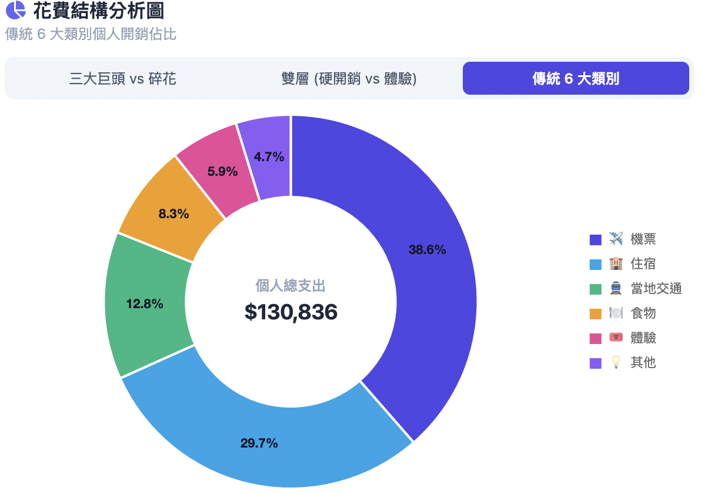 

| 支出類別 | 佔比 | 說明 |
| :--- | :--- | :--- |
| **機票費用** | 約 **38.6%** | 跨國長程機票，為單項最大支出 |
| **住宿費用** | 約 **29.7%** | 15 晚住宿，包含飯店與 Airbnb |
| **當地交通** | 約 **12.8%** | 歐洲跨國高鐵（如 Eurostar）、境內火車與市區地鐵 |
| **餐飲美食** | 約 **8.3%** | 餐廳用餐、外帶速食與超市採買 |
| **景點門票** | 約 **5.9%** | 博物館、美術館與預約景點通行證 |
| **其他雜支** | 約 **4.8%** | 紀念品、洗烘衣、付費廁所與行李寄放等 |

選擇直飛機票雖然貴，但也省去轉機的麻煩與風險。

### 2. 當地餐費估算基準心法

在歐洲外食該如何衡量物價高低？一個簡單實用的參考指標是 **以當地最低時薪作為一餐的平價基準** ：
- 以荷蘭為例，時薪約落在 **13–14 歐元** 之間。
- 如果一餐外食花費 **小於 14 歐元** ，在當地就屬於親民平價水準。
- 若能控制在 **10 歐元以下** （例如在連鎖速食店單點主食、搭配超市飲品），就稱得上非常划算。

### 3. 全感應支付與雙卡防盜刷

- **手機感應支付普及** ：在法比荷三國，從超市、路邊攤販到大眾運輸（法國要用當地悠遊卡，比利時公車刷卡機與當地卡不同），幾乎全境支援 Apple Pay 或 Google Pay。手機感應不僅速度飛快，且不必掏出實體錢包，更能有效防範側錄與盜刷。
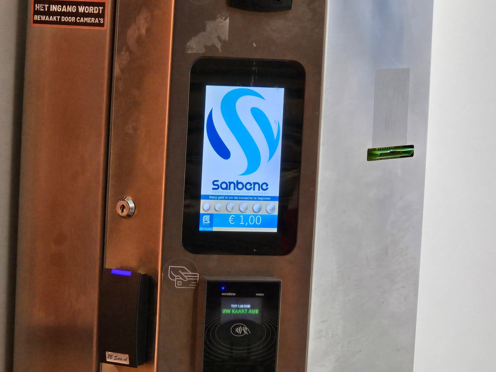
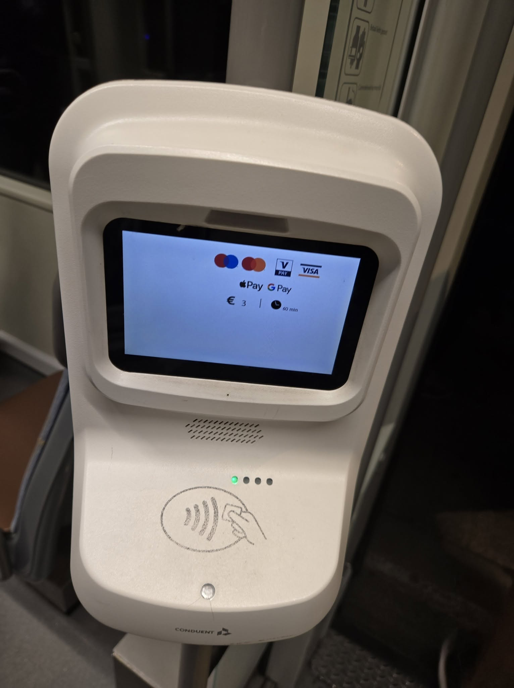

- **雙卡備援策略** ：強烈建議綁定並隨身攜帶 **Mastercard 與 Visa 實體信用卡各一張** ，應對部分古老機台或特定銀行發卡組織無法刷過的窘境。
- **現金使用極少** ：整趟行程準備了 300 歐元現金，最後 **只用到了 26 歐元** ，主要支出都在投幣式洗衣機上。

---

## 四、 法比荷三國文化觀察與生存指南

初次走入歐洲社會，日常生活習慣與城市硬體建設往往帶來不少有趣的文化衝擊。

### 1. 日常生活習慣與細節

- **日期標示格式** ：歐洲日期書寫順序多為 **「日 / 月 / 年」（DD/MM/YYYY）** ，與台灣習慣的「年 / 月 / 日」不同，在超市購買食品查看有效期限時務必多看一眼。
- **連體不分離瓶蓋** ：因應歐盟最新環保法規，寶特瓶蓋設計全面改為連體式（蓋子轉開後依然固定在瓶口環上，無法直接分離），這是為了方便回收處理。
- **建築無冷氣與弱訊號** ：歐洲大部分老式建築、地鐵站與住宅 **普遍沒有裝設冷氣空調** ；加上古建築石牆厚實，走入室內或地下室時手機訊號往往會大幅減弱。
- **寵物極度友善** ：在歐洲搭乘火車或大眾運輸時，經常能看到大型犬隻乖巧地坐在主人腳邊一同乘車，寵物友善程度令人印象深刻。
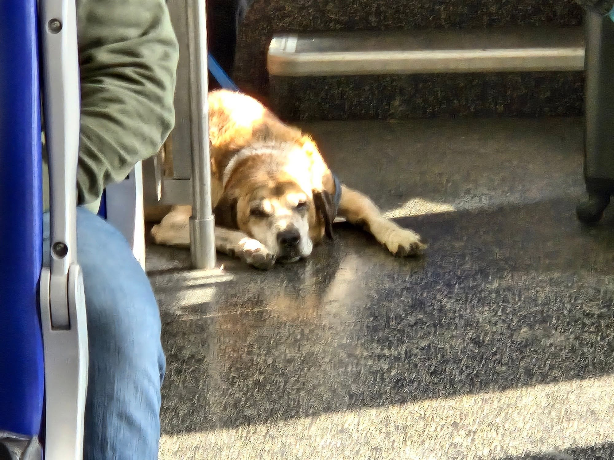
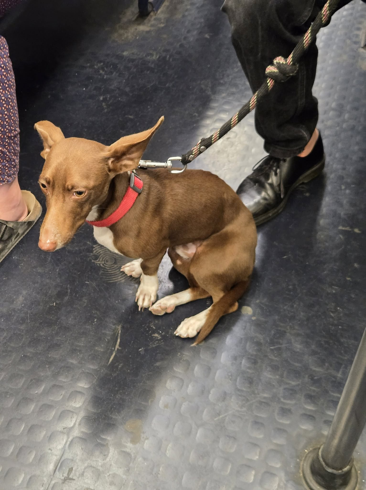

### 2. 大眾運輸與城市硬體

- **手動開關車門** ：在台灣搭捷運或火車車門都是自動開啟，但在歐洲搭乘地鐵與火車，列車停妥後 **必須手動按下車門按鈕或扳動把手** 門才會打開。推測這項設計主要是為了避免車門頻繁開關導致車廂內的暖氣或冷氣流失。
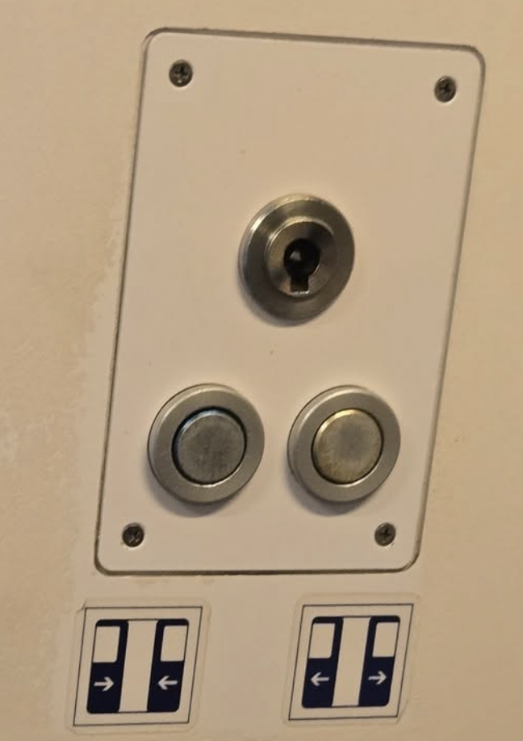

- **硬體特色景觀** ：跨城列車廣泛採用雙層車廂設計（上層視野極佳），市區公車則多為雙節連體鉸接巴士（Articulated Bus），街道的人行道空間也普遍相當寬敞舒適。
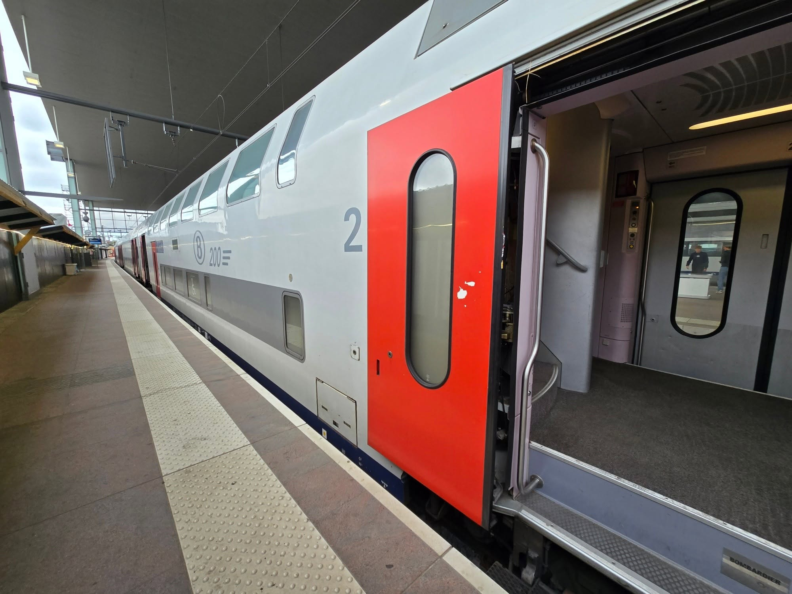
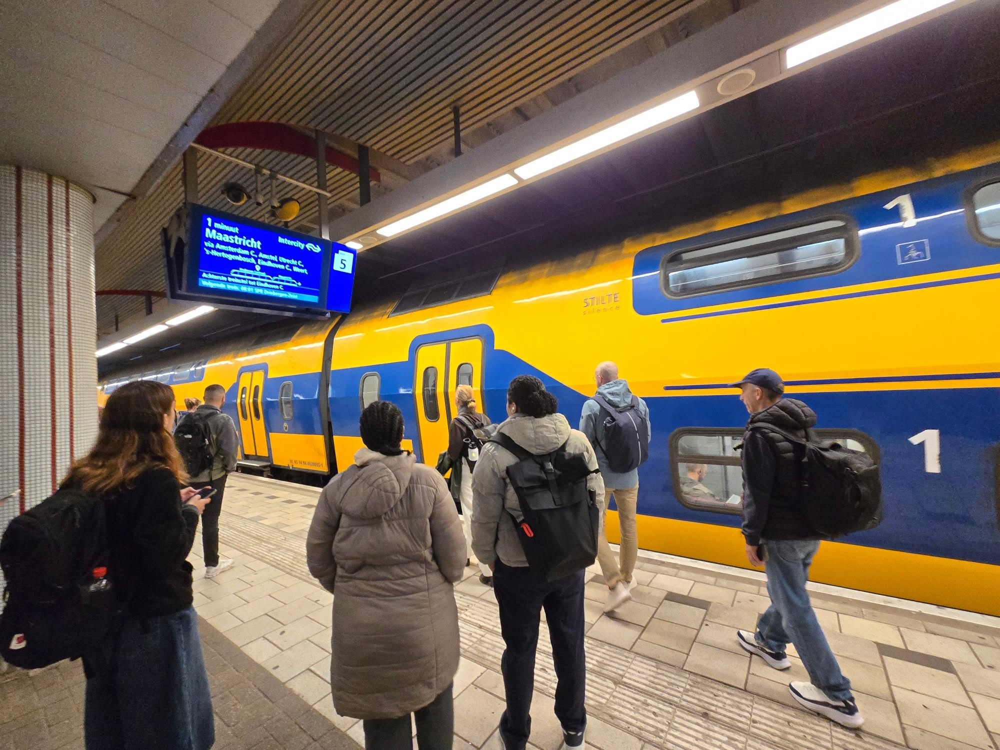
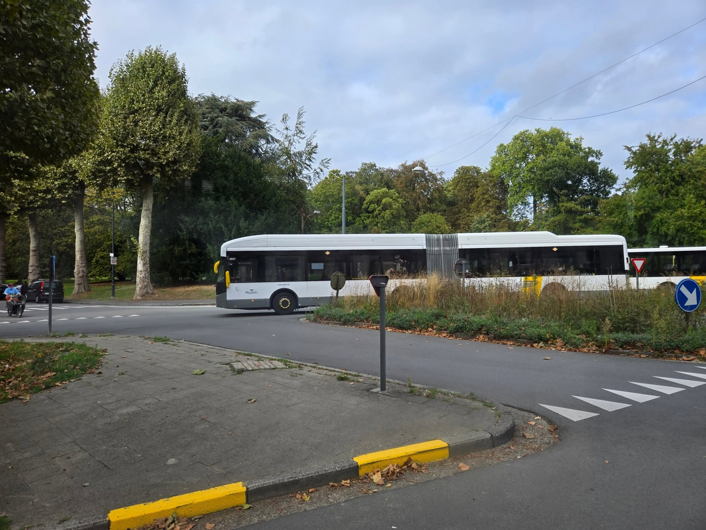
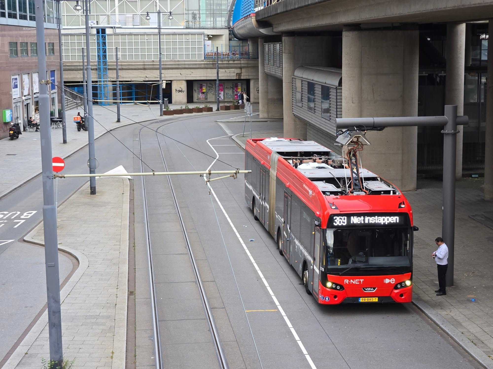

- **樓層計算邏輯** ：歐洲建築的地面層標示為 **Ground Floor（0 樓）** ，往上一層才是 1 樓（First Floor），往地下一層則是 -1 樓。
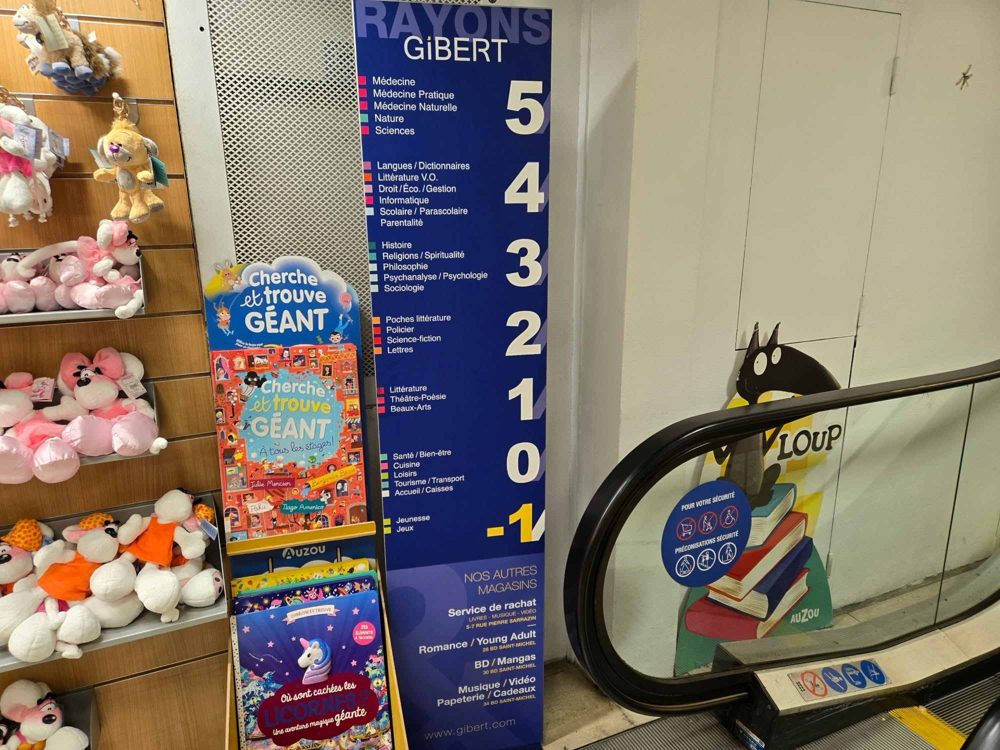

### 3. 建築風貌與生存細節

- **歐洲生存真實痛點** ：
  - **付費廁所文化** ：公共廁所普遍收費 **1 歐元** ，出門在外常需備妥零錢或感應支付卡。
  - **室外吸菸普及** ：歐洲戶外座位區或街道邊吸菸現象相對常見，對菸味敏感者建議挑選座位時多加留意。
  - **住宿據點固定** ：找到距離車站不遠的地方，不會太吵交通又方便，可以省下不少搬遷時間與體力。

---

## ✦ 旅人隨筆｜私房記憶碎片

回顧這 15 天的足跡，最令我感興趣的是三國不同的建築風貌。

### 法國
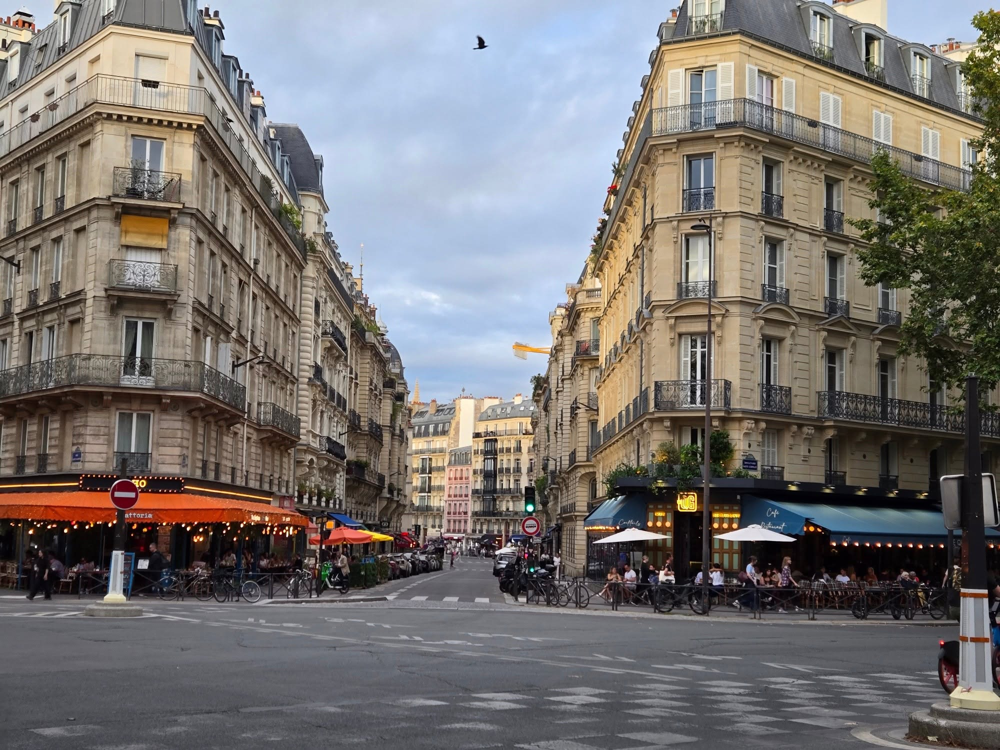

### 比利時
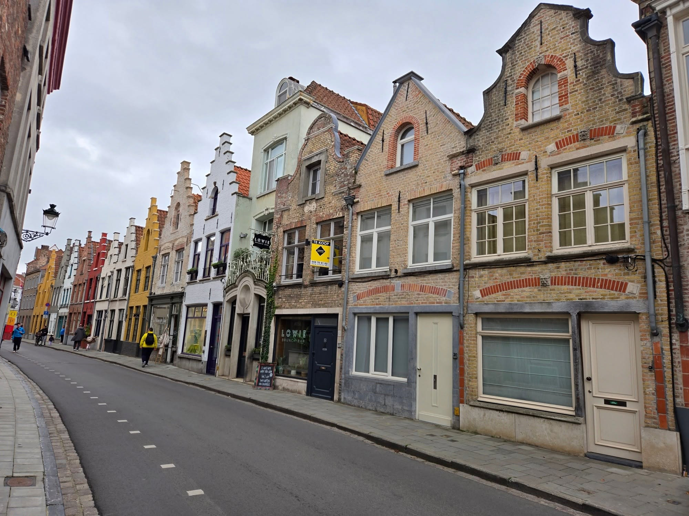

### 荷蘭
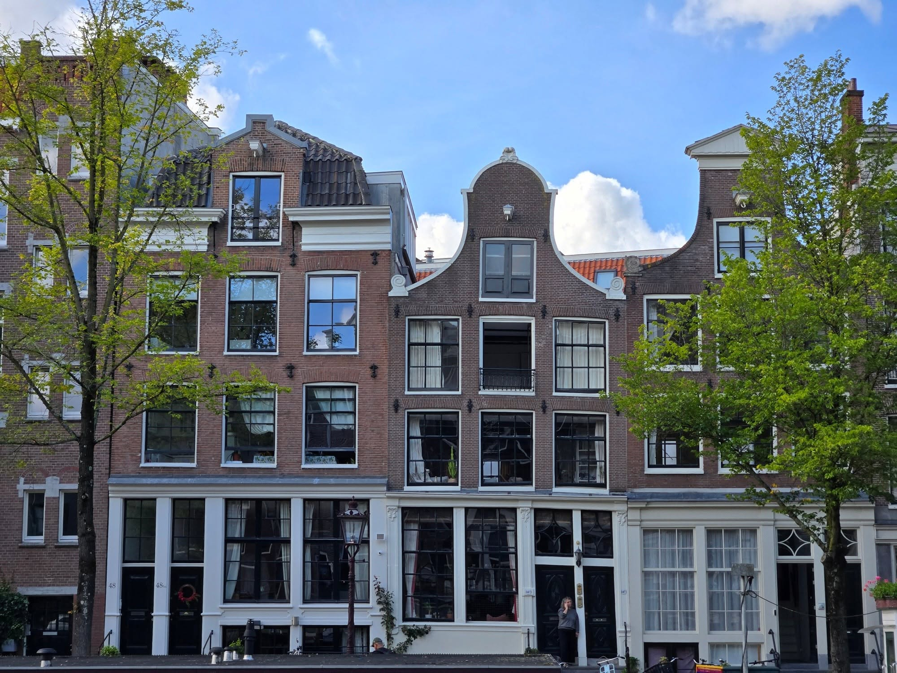
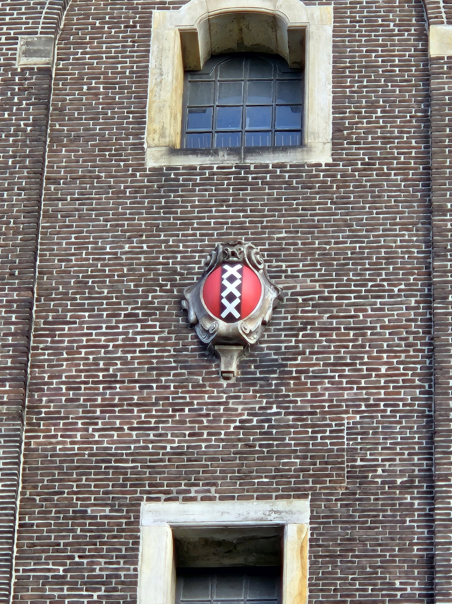

據說ＸＸＸ是荷蘭市徽

---

## 我的連結
- Youtube: https://www.youtube.com/@Daydream-Studio/videos
- Podcast: https://cl4bfh8ww02uu01zgaj2i3d1u.firstory.io/episodes
- FaceBook: https://www.facebook.com/profile.php?id=100082389794254
- Blog: https://nostanduptalk.github.io/

