# [旅遊] 2026歐洲15天 [EP2 巴黎篇] 入境排隊3小時、Bonjour RATP App與三大景點實戰 | 巴黎Paris自由行 | 戴高樂機場CDG | Bonjour RATP | 羅浮宮Musée du Louvre | 凱旋門Arc de Triomphe | 埃菲爾鐵塔Eiffel Tower

踏上巴黎自由行的第一站，迎接的是戴高樂機場長達 3 小時的入境震撼教育！本篇記錄巴黎交通實戰避坑技巧——從免 2 歐押金的 Bonjour RATP App、地鐵進出刷卡邏輯，到市區電車公車的「車速通風法則」；同時帶來羅浮宮、凱旋門與艾菲爾鐵塔三大經典地標的參觀心得。
<!--more-->

## 一、 巴黎入境與交通住宿實戰

抵達巴黎的第一天，各項交通與住宿安排直接考驗旅人的應變力。提早掌握規則，能省下許多寶貴的旅行時間與體力。

### 1. 戴高樂機場 CDG 入境通關經驗

- **通關排隊長達 3 小時** ：抵達巴黎戴高樂機場（CDG）時，入境查驗人潮超出預期，排隊通關竟然整整花了 **3 個小時** 。
- **行程規劃心法** ：抵達首日強烈建議 **不要安排過於緊湊的行程或無法改期的票券** ，下機後的交通轉乘時間務必預留足夠彈性。

### 2. 住宿選擇心法：鄰近車站是王道

- **距離車站走路 7 分鐘內** ：活用大眾運輸。
- **每日轉乘高效省力** ：住在離主要車站不遠處，每天出門搭車、回程卸貨或跨城市換據點都非常輕鬆，大幅減輕旅途負擔。

### 3. 法國交通工具實戰與風速通風邏輯

巴黎的大眾運輸歷史悠久，搭乘時有一些與亞洲捷運截然不同的運作規則：

- **指標斷層避坑指南** ：
  - 法國部分舊式地鐵站與轉運站的導引指標容易出現「斷層」，轉乘時需要特別細心核對月台與方向。
  - **重要提醒** ：在站內摸索路線時 **千萬不要輕易走出閘門出站** ！一旦誤出站，重新進站就必須被扣一次車資。
  - 認明法文出口標示：跟著 **「Sortie」** 走即是出口方向。
- **慢速車開窗 vs 高速車冷氣（車速通風邏輯）** ：
  - 法國的市區公車與電車等慢速交通工具，車內基本 **依靠開窗吹自然風通風** 。
  - **時速較低的交通工具** （如公車、市區電車）：窗戶通常都會打開；但遇到豔陽天且車輛停等紅燈或塞車不動時，車內會非常悶熱。
  - **時速高的交通工具** （如長途火車、TGV 高鐵）：車廂則配備空調且全面緊閉車窗。
- **進出站刷卡規則** ：
  - **巴黎地鐵與公車** ：進站／上車時必須感應刷卡；**下車／出站時直接走出去，完全不需要刷卡** 。
  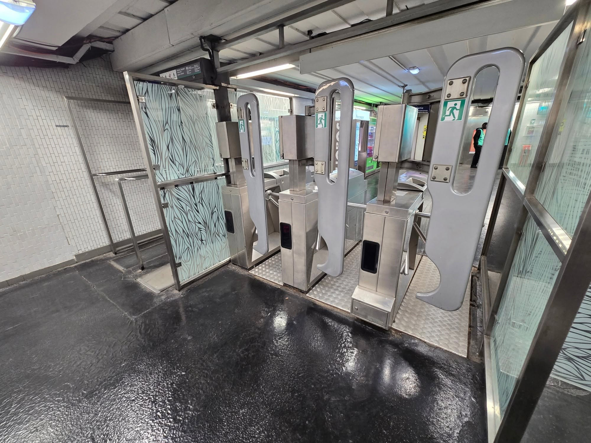

  - **TGV 高鐵** ：沒有閘門，但會確認你的 QR Code 。
- **數位神隊友：Bonjour RATP App** ：
  - 建議出發前直接在手機下載 **Bonjour RATP App** 。
  - 手機可以直接購買交通票券（如單程票、機場路線票）並透過 NFC 感應進站，**省去購買實體 Navigo 交通卡所需的 2 歐元製卡押金** ，既省事又省錢。
  - 也可以透過Bonjour RATP App 在自己的手機上幫忙儲值實體票卡
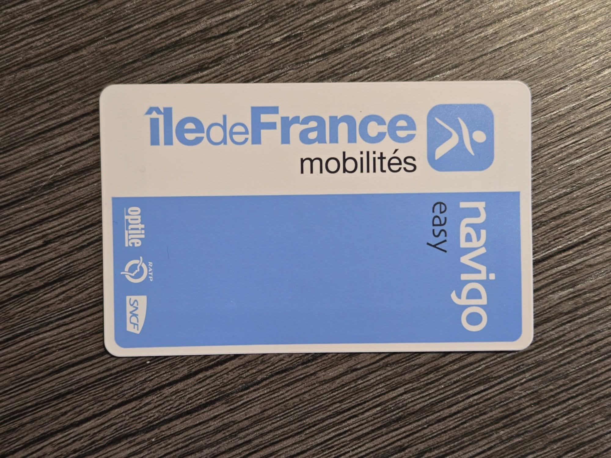

---

## 二、 巴黎三大經典地標實戰

來到巴黎，艾菲爾鐵塔、羅浮宮與凱旋門是必訪的重點地標，掌握參觀節奏與現場應對能讓體驗大幅升級。

### 1. 埃菲爾鐵塔（Eiffel Tower）

- **周邊推銷應對心法** ：鐵塔周圍常有許多兜售紀念品但不會強迫推銷人員。
- **順利通關秘訣** ：面對推銷時，只需 **保持眼神堅定、不理會、不眼神接觸並持續向前走** ，他們通常不會過度糾纏，即可順利穿過廣場。

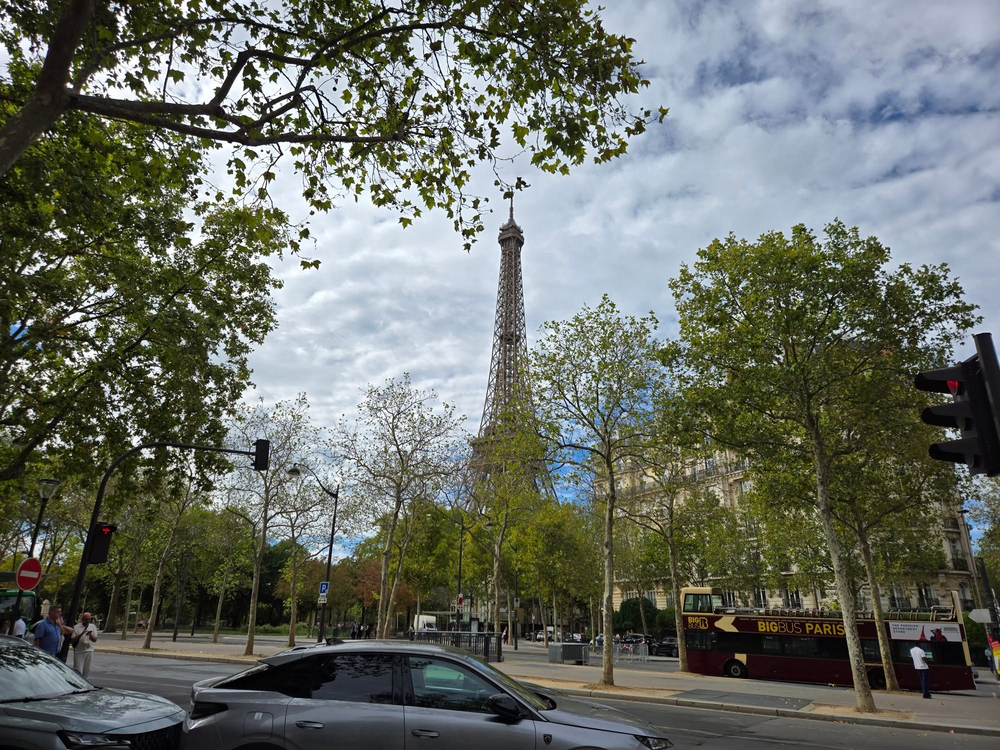

### 2. 羅浮宮（Musée du Louvre）

- **早鳥預約首選** ：建議務必提前預約 **上午 9:30 的早鳥場次** 。剛開館時人潮最少，無論是參觀《蒙娜麗莎》或是知名雕塑都能享有最佳的觀展品質。
- **白色禮服版本** ：雅克-路易·大衛（Jacques-Louis David）創作的《拿破崙一世加冕禮》（Le Sacre de Napoléon）有兩幅幾乎一模一樣的真跡巨幅畫作，分別收藏於羅浮宮與凡爾賽宮。

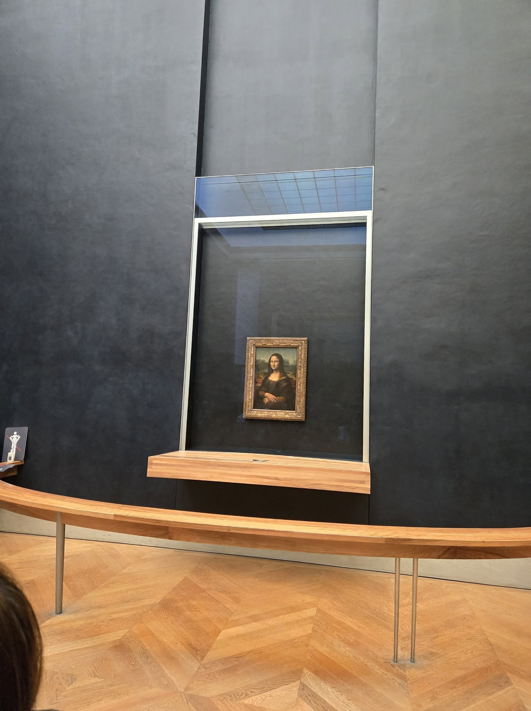

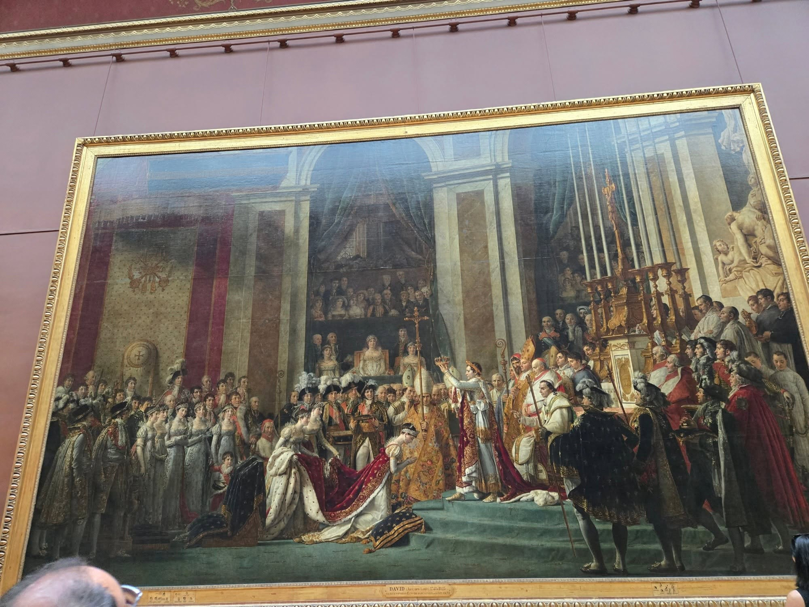

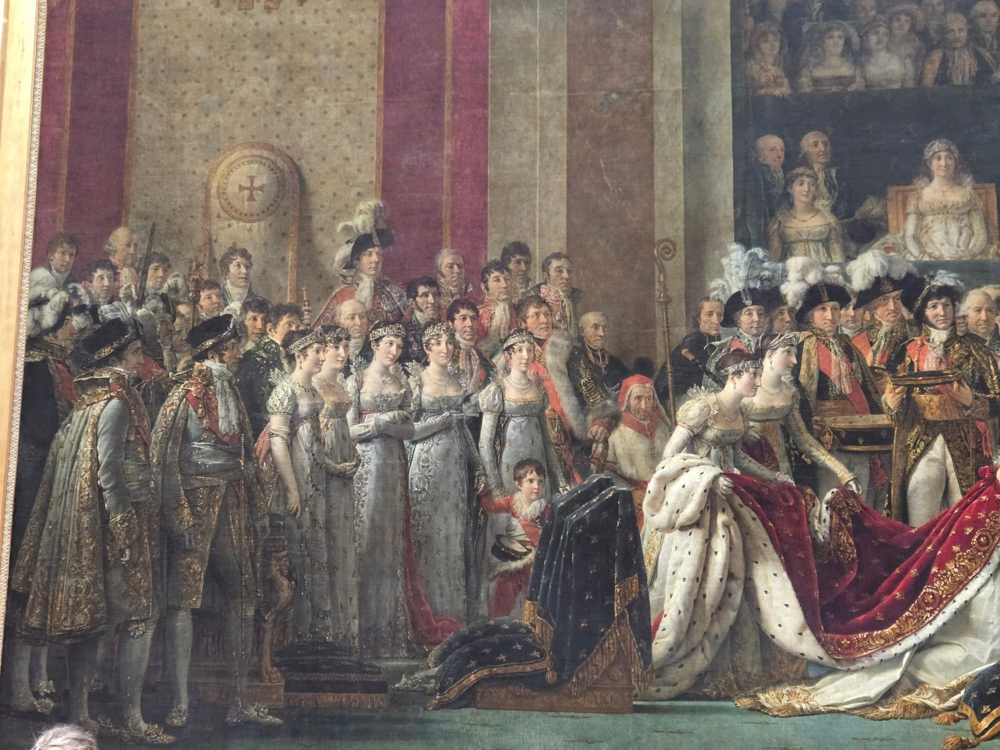

### 3. 凱旋門（Arc de Triomphe）

- **登頂俯瞰視角** ：很累的爬完旋轉階梯登上凱旋門頂端，視野豁然開朗。
- **12 大道交會奇景** ：在頂端可以俯瞰以凱旋門為中心、向外放射狀延伸的 12 條林蔭大道，車輛在毫無交通號誌閘門的巨大圓環中穿梭流動，展現獨特的城市交通流線之美。

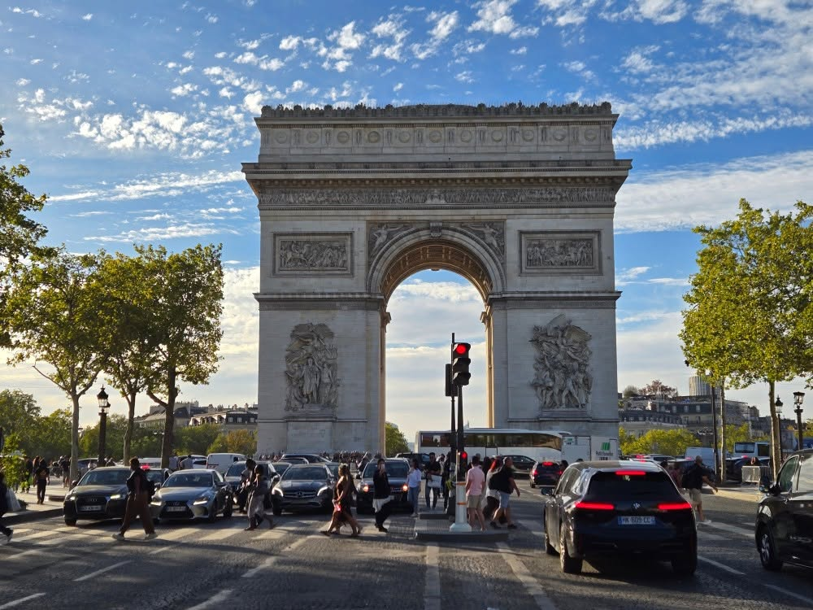
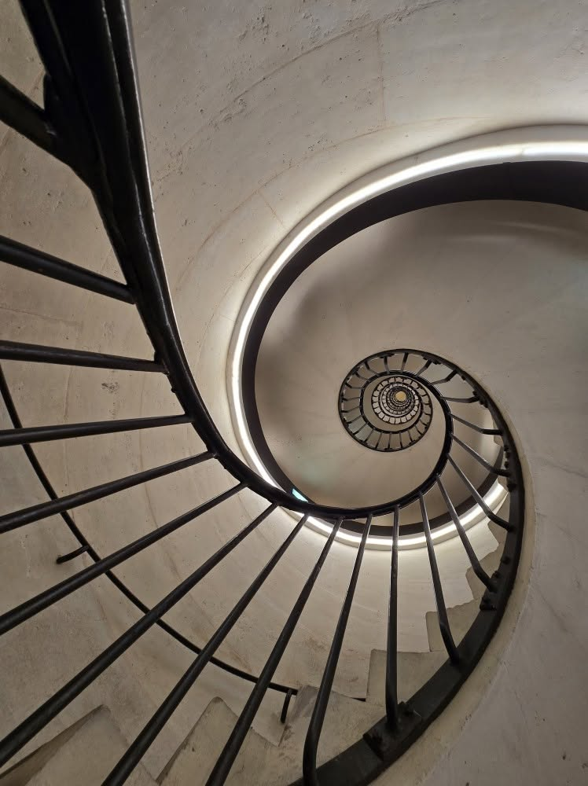

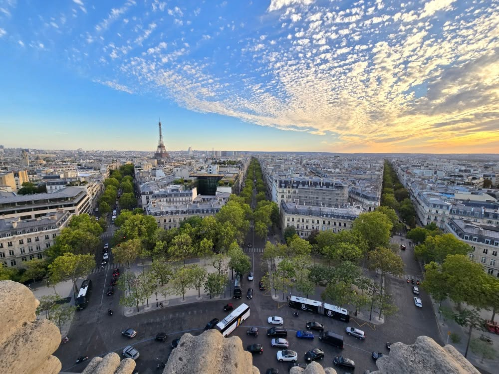
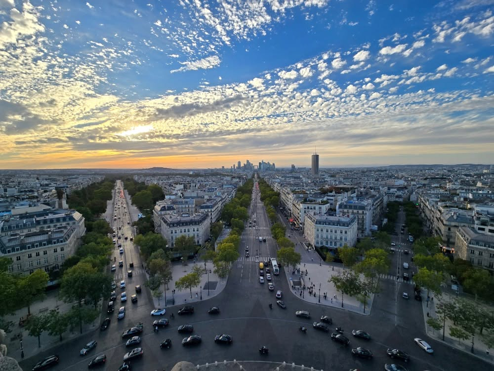

---

## ✦ 旅人隨筆｜私房記憶碎片
走進巴黎舊式地鐵站，半圓形白色的拱頂天花板。
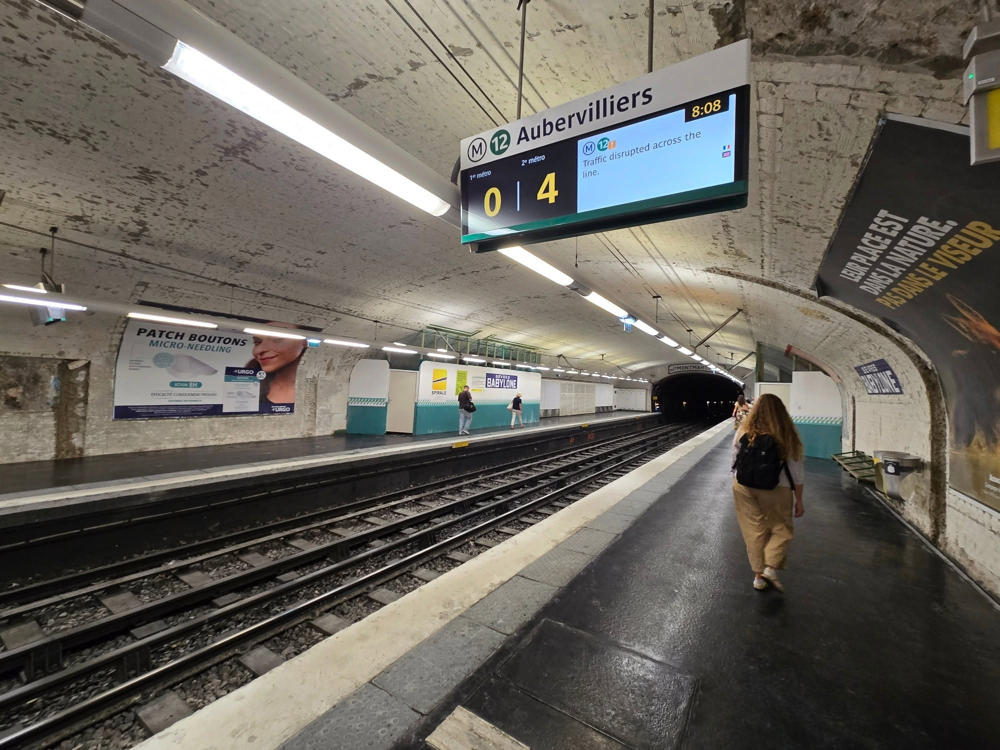

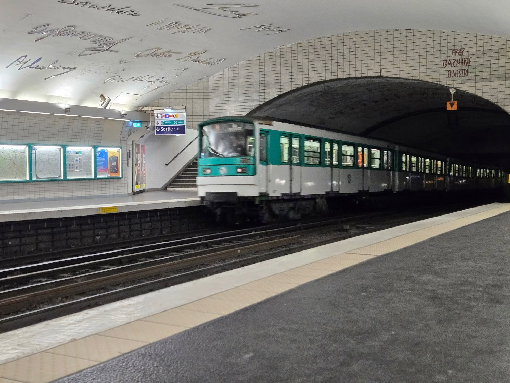

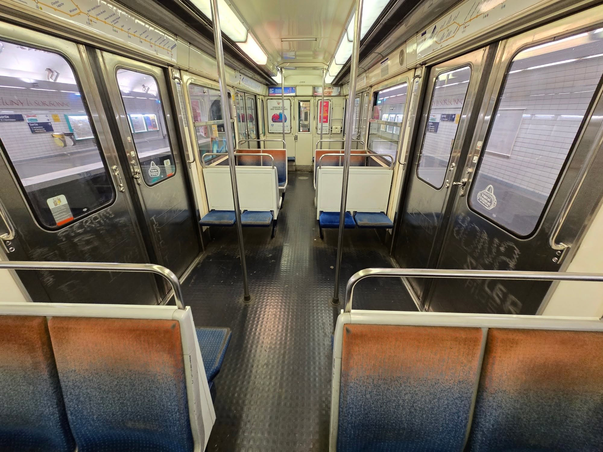
---

## 我的連結
- Youtube: https://www.youtube.com/@Daydream-Studio/videos
- Podcast: https://cl4bfh8ww02uu01zgaj2i3d1u.firstory.io/episodes
- FaceBook: https://www.facebook.com/profile.php?id=100082389794254
- Blog: https://nostanduptalk.github.io/

