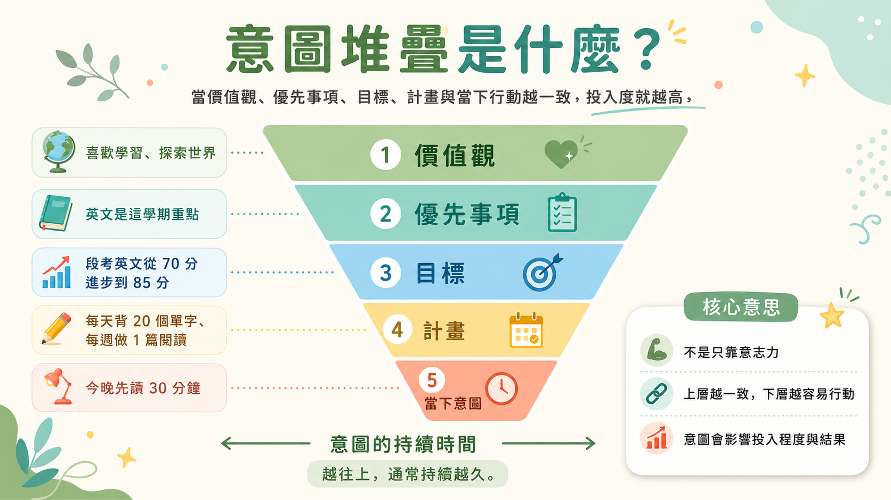
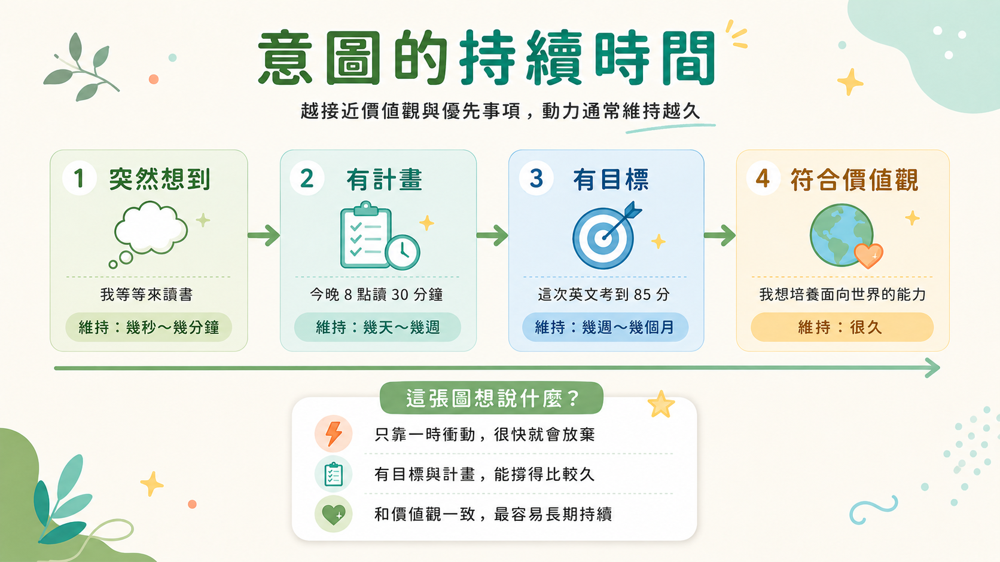
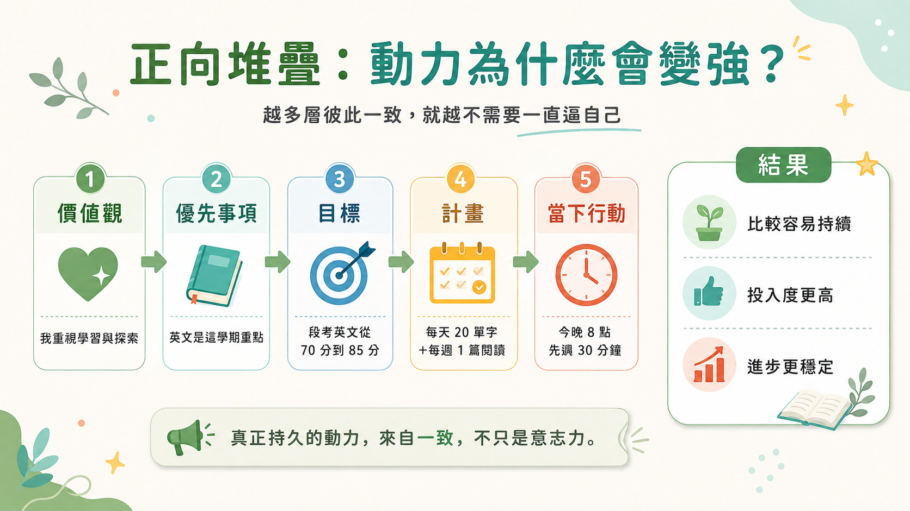

# [筆記] 為什麼做不久？當你沒動力的四個檢查

當價值觀、優先事項、目標、計畫與當下行動越一致，投入度就越高。
<!--more-->
## 參考資料
- [https://gipi.tw/how-to-finish-what-you-start/](https://gipi.tw/how-to-finish-what-you-start/)
- [https://chrisbailey.com/the-intention-stack/](https://chrisbailey.com/the-intention-stack/)

## 簡報

## 我的連結
- Youtube: https://www.youtube.com/@Daydream-Studio/videos
- Podcast: https://cl4bfh8ww02uu01zgaj2i3d1u.firstory.io/episodes
- FaceBook: https://www.facebook.com/profile.php?id=100082389794254
- Blog: https://nostanduptalk.github.io/

