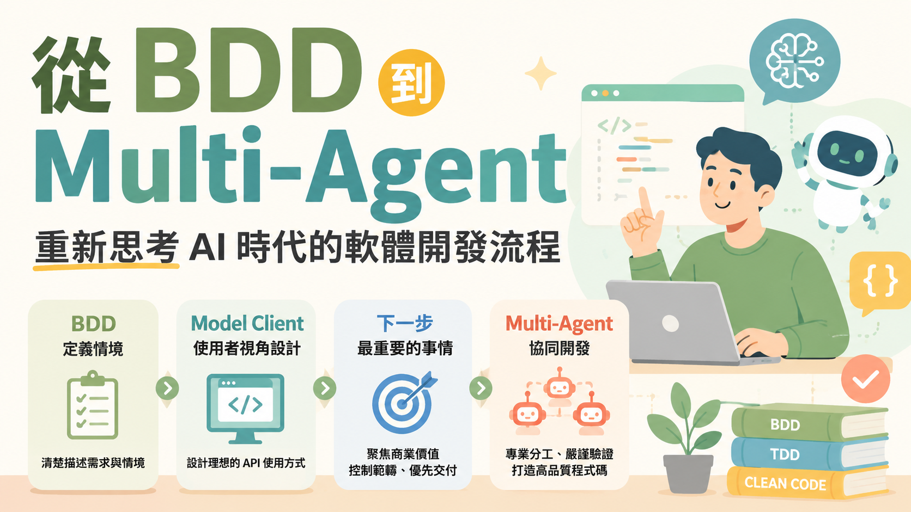
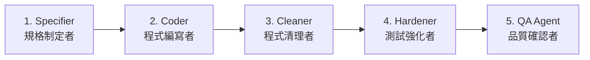

# [筆記] 從 BDD 到 Multi-Agent：重新思考 AI 時代的軟體開發流程

在 AI 輔助編程迅速普及的時代，如何避免大型語言模型產出脆弱混亂的程式碼、克服情境視窗（Context Window）的長文本遺忘問題？本文從行為驅動開發（BDD）的 **Given–When–Then** 語法、**Model Client（模型客戶端）** 的自私設計哲學，探討軟體大師 Uncle Bob 所提出的 **多代理協同工作流（Multi-Agent Workflow）**，深入拆解 AI 時代下高品質軟體開發的管線化實踐。
<!--more-->

---

參考連結：

[https://www.youtube.com/watch?v=zcLPGC-tvgk](https://www.youtube.com/watch?v=zcLPGC-tvgk)

[https://www.youtube.com/watch?v=YUkk2lGLxjA](https://www.youtube.com/watch?v=YUkk2lGLxjA)

## 一、BDD 語法：Given–When–Then 的本質與情境

行為驅動開發（Behavior-Driven Development, BDD）不僅僅是一套測試框架，更是一種促使團隊在撰寫程式碼前，**清楚定義系統情境（Scenarios）與上下文關係（Context）** 的思考與溝通模板。

### 1. 演進由來：為什麼只有操作與結果是不夠的？

在敏捷開發初期，團隊常在實體卡片背面記錄使用者需求，格式通常十分單純：

- 「我做了這個（I do this）」
- ➡️ 「發生了這個（This happens）」

商業分析師（Business Analyst, BA）Chris Matz 敏銳地指出：這樣的描述存在嚴重漏洞。因為 **相同的操作在不同的前提背景（Context）下，會產生完全不同的結果**。

例如「輸入密碼」這一行為：
- 在「密碼正確」的前提下，系統應跳轉至主頁。
- 在「密碼已連續錯誤兩次」的前提下，再次輸錯則會直接鎖定帳號。

若忽略前提狀態，系統的行為規範就變得模糊且脆弱。

### 2. 三段式結構

為了完整補足上下文，團隊將需求結構演進為標準的 **Given–When–Then** 語法：

| 語法 | 核心意義 | 說明 | 實務範例 |
| :--- | :--- | :--- | :--- |
| **Given** | 假設／前提 | 設定系統當前的初始狀態或環境背景 | `Given 使用者已輸入正確帳號` |
| **When** | 當／操作 | 觸發系統行為的使用者操作或外部事件 | `When 按下登入按鈕` |
| **Then** | 則／結果 | 預期獲得的觀察結果或系統響應行為 | `Then 成功進入系統主頁` |

---

## 二、Model Client（模型客戶端）：以消費者為中心的設計

許多工程師對於「寫測試（Writing Tests）」存在心理抗拒與職責劃分的爭議。講者為了推廣 **測試驅動開發（TDD）**，提出了「**Model Client（模型客戶端）**」的概念，讓團隊以更優雅的視角切入軟體架構。

### 1. 擺脫「Test」的心理包袱

當專案中要求「先寫測試」時，開發者常覺得這是在增加額外負擔；但如果將對話轉變為：

> 「我們來寫一個 **Model Client（模型客戶端）**，用來描述程式的預期行為與使用方式。」

工程師的思維就會從「驗證找碴」轉變為「API 設計與消費者體驗」。

### 2. 消費端視角 vs 服務端視角

傳統 API 設計往往落入「服務端／實作端（Server/Service Perspective）」的盲點：先考慮資料庫如何存、內部模組如何劃分，最後才拼湊出 API 接口。這常導致：
- API 呼叫流程繁瑣冗長。
- 參數暴露了不必要的底層實作細節。
- 無法直觀滿足終端使用者的實際場景。

**Model Client** 要求開發者徹底反轉視角：**完全站在 API 使用者（消費端）的立場出發**。

### 3. 「極度自私」且完美的設計哲學

在尚未撰寫任何底層實作程式碼之前：

1. 先寫一段呼叫該功能或模組的客戶端程式碼（Model Client）。
2. 在撰寫這段程式碼時，態度要 **「極度自私」**。
3. 假想：
   - 整個世界完全圍繞著你的需求運轉。
   - 這個 API 已經完美無瑕地存在於世上。
   - 它就是專門為解決你當前的痛點而精心打造的。
4. 在這種假想下：
   - 函式名稱與呼叫參數是最優雅的。
   - 回傳格式是最容易取用的資料結構。
   - 錯誤處理機制完全符合直覺。
5. 寫完這個理想中的假想客戶端後，再去實作底層邏輯，讓美好的設計落地成真。

---

## 三、「下一步最重要的事情」：邊界控制與漸進交付

在 BDD 的核心哲學中，**The Next Most Important Thing（下一步最重要的事情）** 是引導團隊排定開發優先順序與嚴格控制範疇（Scope）的最高原則。

### 1. 專注商業價值的交付

軟體工程的終極目標不是在沙盒中做無止境的學習與抽象，而是 **解決實際問題、為企業與使用者交付真實商業價值**。

因此，BDD 時刻引導開發者捫心自問：

> **「這個系統目前還缺少的『下一個最重要功能』是什麼？」**

### 2. 情境與邊界條件的完整拆解

當確定了下一個核心功能（例如「提款機吐鈔」）後，接著思考該功能涵蓋的情境邊界：

1. **最核心／最頻繁的情境（Happy Path）**：
   - 例如：提款機內現金充裕，且帳戶餘額充足。
   - 優先開發並完成端到端驗證。
2. **關鍵邊界情境（Edge Cases）**：
   - 例如：提款機餘額不足、帳戶透支、網路中斷等。
   - 依重要性與風險遞減排定實作順序。

### 3. 明確定義範疇，拒絕過度工程

團隊在當下只針對 **已經明確定義並納入排程的情境** 進行編程與測試：
- 若在開發過程中發現潛在未覆蓋的邊緣案例，將其記錄為未來的待辦項目（Backlog）。
- 避免在當前任務中漫無邊際地發散與過度設計。
- 確保團隊每一步都能穩定交付核心價值。

---

## 四、Multi-Agent Workflow：AI 時代的軟體流水線

當生成式 AI 走入軟體開發，許多人試圖透過一個超長的 Prompt 讓單一 LLM 完成從需求到測試的所有程式碼，然而這往往帶來兩大困境：
- **Context Window（情境視窗）過載與長文本遺忘（Lost in the Middle）**：模型在面對長上下文時容易遺忘中間的關鍵約束。
- **產出低劣脆弱的程式碼（Uncle Bob 所稱的 "dog do"）**。

為此，Uncle Bob 提出了 **多代理協同工作流（Multi-Agent Workflow）** 的系統化架構。

### 核心哲學：極度單一任務與狀態歸零

> **不依靠單一 AI 包辦全場，而是將工作切分為多個專門的 Agent（代理），形成一條精密的軟體製造工廠流水線。**

- **極簡單一職責**：每個 Agent 只專注於極其微小且明確的單一任務。
- **即刻銷毀與乾淨 Context**：任務完成後即銷毀該 Agent，下一個 Agent 接手時帶著最乾淨、精準的情境視窗啟動，徹底避免上游累積的無效推理與軌跡干擾（Trajectory Contamination）。

---

## 五、各 Agent 的職責分工與執行順序

這套流水線如同嚴格的闖關檢驗（The Gauntlet），確保產出的每一行程式碼都具備最高工業水準：

### 1. Specifier（規格制定者）

- **任務**：
  - 讀取人類開發者寫下的需求描述與商業邏輯。
  - 將需求轉換為標準的 **Girkin（Given–When–Then 格式驗證清單）** 與高階 QA 驗收步驟。
- **定位**：
  - 完全從使用者／人類視角出發，在動工前先定好「如何證明系統運作正確」的驗收準則。

### 2. Coder（程式編寫者）

- **任務**：
  - 接收 Specifier 制定的規格與測試準則。
  - 撰寫單元測試（Unit Tests）與實作功能程式碼。
  - 確保所有 Girkin 測試順利跑通。
- **特性**：
  - 講求快速產出與邏輯貫通。
  - 允許暫時存在不夠優雅的實作，因為後續有專責角色進行整理。

### 3. Cleaner（清理者）

- **任務**：
  - 針對 Coder 產出的程式碼進行 **CRAP 分析**（結合程式碼複雜度與測試覆蓋率的指標）以及嚴謹的 Code Review。
  - 重構程式碼、提取重複邏輯、消除壞味道（Code Smells），確保結構清晰可讀。

### 4. Hardener（強化者）

- **任務**：
  - 執行極度嚴苛的 **變異測試（Mutation Testing）**。
  - 自動置換或翻轉程式碼中的邏輯運算子（例如將 `+` 改為 `-`、`<` 改為 `>`、修改常數邊界等）。
- **定位**：
  - 檢驗測試套件是否能 **100% 捕捉到人為刻意注入的邏輯瑕疵**，確保單元測試具備絕對真實的防護力，而非虛高的行覆蓋率。

### 5. QA Agent（品質確認者）

- **任務**：
  - 將最初 Specifier 撰寫的高階 QA 步驟轉換為可自動執行的系統整合測試腳本。
  - 直接在系統介面或模擬環境中跑完端到端測試，完成最終驗收。

---

## 六、多代理架構的優勢與代價

### 1. 核心優勢

- **精準控制情境視窗（Context Window）**：
  每個 Agent 的指令（Prompt）維持極度精煉，大幅降低幻覺發生率。
- **維持乾淨的推理狀態**：
  Agent 誕生、執行、結束後銷毀。下游 Agent 不會受到上游過多推導細節或無關對話的干擾，保持最佳決策品質。
- **無懈可擊的程式碼品質**：
  經過 Spec 驗證、重構清理、變異測試的多重檢驗關卡，程式碼的健壯性與可維護性甚至超越許多人類工程師單打獨鬥的水準。

### 2. 成本代價與綜合效益

| 評估維度 | 單一 AI 對話開發 | 多代理協同流水線 (Multi-Agent) | 人類工程師純手寫 |
| :--- | :--- | :--- | :--- |
| **執行耗時** | 約 5 分鐘 | 約 1 小時（含啟動與狀態轉換） | 約 4 小時 |
| **品質穩定度** | 浮動較大、易殘留隱蔽 Bug | 極高、經過重構與變異測試驗證 | 依個人資歷經驗而定 |
| **Context 負擔** | 隨對話增長急遽退化 | 始終維持極簡乾淨狀態 | 人腦注意力易耗盡疲乏 |

雖然多代理流水線比單次生成耗時更長，但相較於人類開發者仍有 **4～5 倍的效率提升**，更重要的是解決了 AI 在大型專案中難以維持高品質與高可靠度的致命難題。

---

## 總結

從敏捷時代的 **BDD（Given–When–Then）** 到 **Model Client** 的設計哲學，其精髓都在於 **「以終為始、定義邊界、為使用者而設計」**。

在邁入 AI 驅動開發的今天，Uncle Bob 的 Multi-Agent 工作流將這套經典工程思維完美移植到了智慧代理架構中：透過將龐大問題拆解為專注的微型任務，並以嚴密的測試流水線建立防護網，軟體工程師能真正馴服 AI，建構出可持續演進的高品質現代軟體系統。

---

## 我的連結
- Youtube: https://www.youtube.com/@Daydream-Studio/videos
- Podcast: https://cl4bfh8ww02uu01zgaj2i3d1u.firstory.cc/episodes
- FaceBook: https://www.facebook.com/profile.php?id=100082389794254
- Blog: https://nostanduptalk.github.io/

