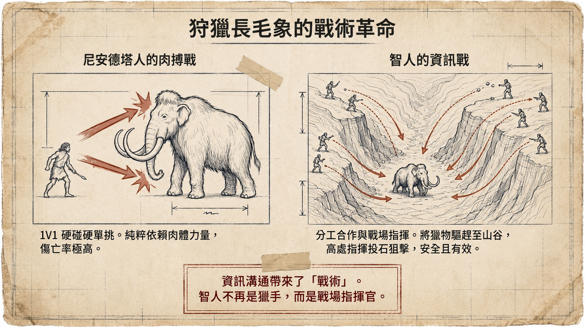
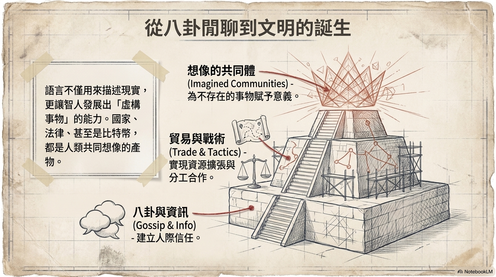

# [筆記] 智人與尼安德塔人：演化競爭、資訊力量與想像共同體

在演化競爭中，為何身體更壯碩、腦容量更大的尼安德塔人會走向滅絕？關鍵不在於個體生理蠻力，而在於智人具備以資訊交流擴大組織規模，並藉由虛構價值凝聚萬人合作的關鍵能力。
<!--more-->

參考影片：[YouTube - 智人與尼安德塔人演化探討](https://www.youtube.com/watch?v=XEd2A9VR-qc)

---

## 一、 生理素質與智力對照：並非腦袋大就決定一切

在直覺上，我們常認為智人之所以統治地球，是因為我們擁有最高等的智慧與發達的大腦。然而考古與人類學研究揭示了令人意外的事實：

- **身體結構優勢** ： **尼安德塔人（Neanderthals）** 在生理素質上遠比 **智人（Homo sapiens）** 更壯碩，具備更厚實強健的骨骼與肌肉。
- **腦容量差距** ：尼安德塔人的 **腦容量其實比智人還要大** 。

這項對比清楚說明：智人最終的生存勝出， **並非** 單純來自個體智慧高低或大腦體積的大小。

---

## 二、 智人的核心競爭力：聊天與資訊的力量

如果單兵作戰打不贏，智人究竟憑什麼在殘酷的演化舞台中脫穎而出？答案是 **「資訊傳播」** 。

### 1. 八卦（Gossip）與聊天的演化意義
智人與其他物種最本質的差異，在於我們具備高度發展的 **「聊天」** 與社交溝通能力。透過八卦與閒聊，社群成員能掌握彼此的信用、性格與群體動態。這種資訊流動成為群體生存與擴張不可或缺的戰略資源。

### 2. 社會組織規模的量級突破
- **尼安德塔人** ：缺乏高效的溝通機制，部落規模受到認知上限約束，通常僅能維持在約 **150 人** 的極限。
- **智人** ：藉由溝通形成緊密的社群認同感（Community），使部落與群體規模得以打破限制，擴張至 **上萬人** 。

### 3. 跨地域長程貿易網絡
因為具備語言溝通與建立信任的機制，智人很早就發展出廣泛的長途貿易網絡。
考古發掘顯示，智人的墓葬品中常有來自 **數百公里乃至上萬公里外** 的珍稀物資；相反地，尼安德塔人的活動範圍與資源獲取，往往僅受限於棲地周邊。

---

## 三、 策略協作與集體狩獵

組織規模的優勢直接反映在獲取生存資源的效率上。

- **戰術思維的差異** ：
  - **尼安德塔人** ：獵捕長毛象等巨型哺乳動物時，傾向採取近距離的 **「一對一、硬碰硬」** 單挑肉搏，造成高傷亡且風險極大。
  - **智人** ：善用語言溝通進行 **任務分類與戰術指揮** 。智人會事先規劃策略，將獵物驅趕至預設的山谷或斷崖進行圍獵，靠的是群體智慧而非蠻力。
- **高度分工與集體行動** ：智人群體能夠聽從統一指揮、緊密協同作業，將整體的綜效發揮到極致，在生存物資競爭中取得絕對優勢。

---

## 四、 想像共同體：虛構價值的信仰

智人演化中最具革命性的飛躍，是能夠相信 **「不存在的實體」** 。

### 1. 穿透現實的虛構能力
智人擁有建構與相信 **「想像共同體（Imagined Communities）」** 的天賦。舉凡：
- 國家與城邦
- 法律規範與社會制度
- 貨幣乃至現代的加密貨幣（比特幣）

這些概念在客觀物理世界中皆不存在，完全是智人群體透過語言與符號共同定義、共同認可的 **虛構概念** 。

### 2. 為了共同價值奉獻的大規模合作
智人是地球上唯一會為了 **「虛構價值」** 或 **「想像共同體」** 主動犧牲奉獻生命的物種。
正是這份對超現實共同信念的追求，讓成千上萬互不相識的陌生個體，能夠跨越血緣限制，朝向同一個目標展開超大規模的協同合作。

---

## 總結

智人的成功與統治地位， **絕非來自單一個體的強大** ，而是建構於兩大支柱之上：
1. 透過 **語言交流與資訊傳遞** ，打破人數限制，建立龐大的社會網絡；
2. 憑藉 **想像共同體與虛構價值** ，使跨群體、跨地域的萬人大協作成爲可能。

---

## 我的連結
- Youtube: https://www.youtube.com/@Daydream-Studio/videos
- Podcast: https://cl4bfh8ww02uu01zgaj2i3d1u.firstory.cc/episodes
- FaceBook: https://www.facebook.com/profile.php?id=100082389794254
- Blog: https://nostanduptalk.github.io/

