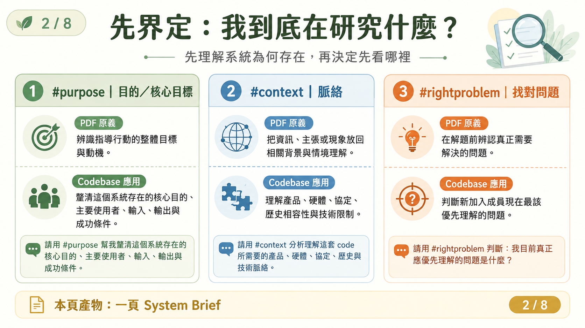
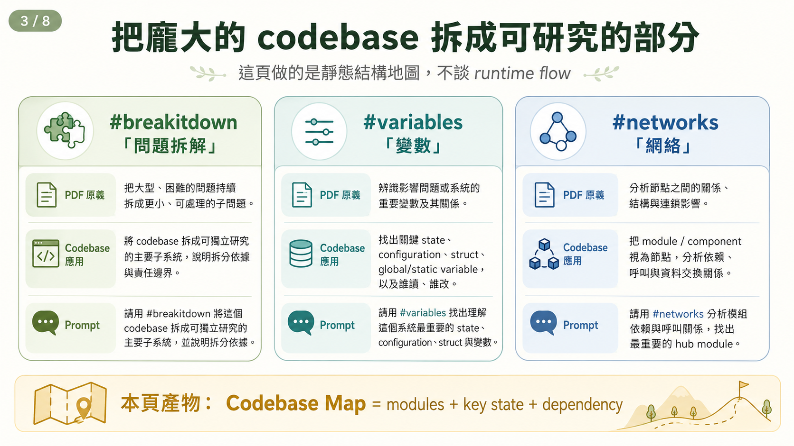
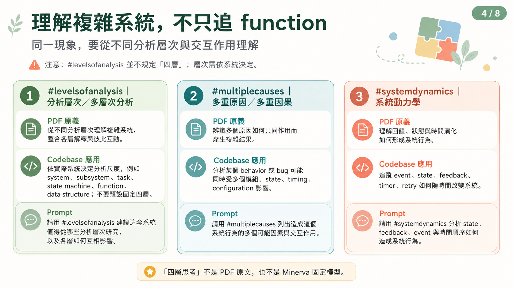
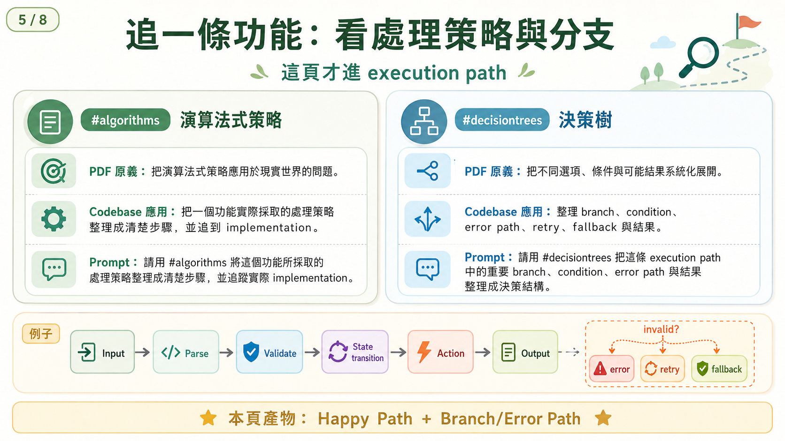
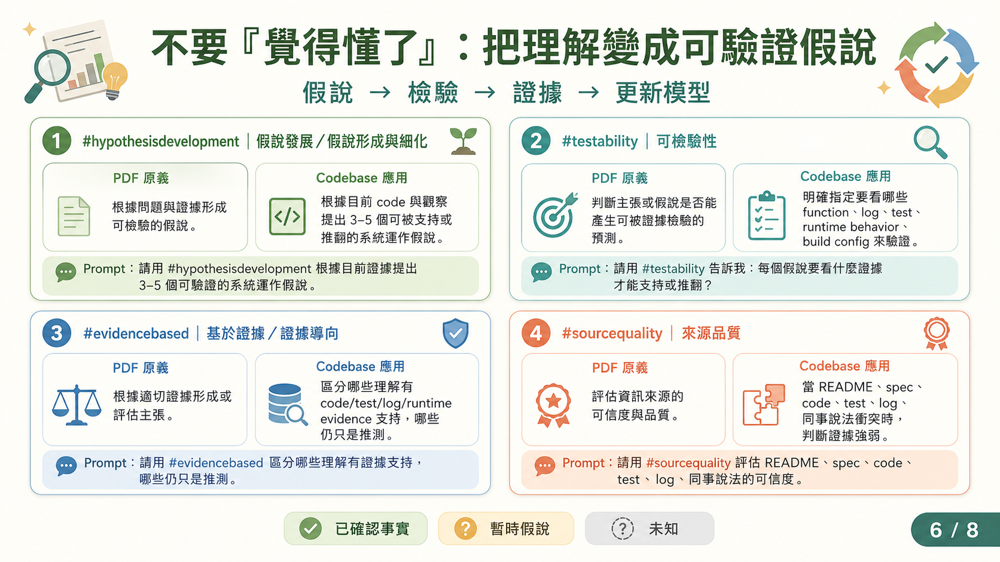
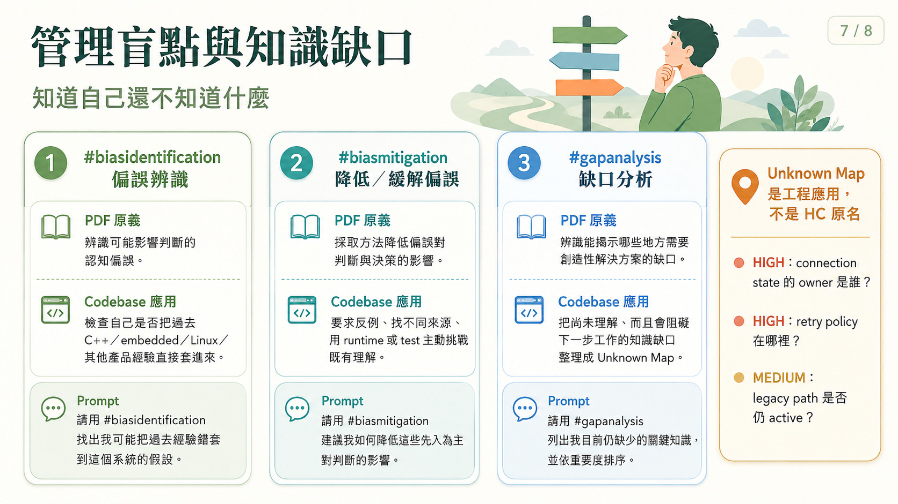
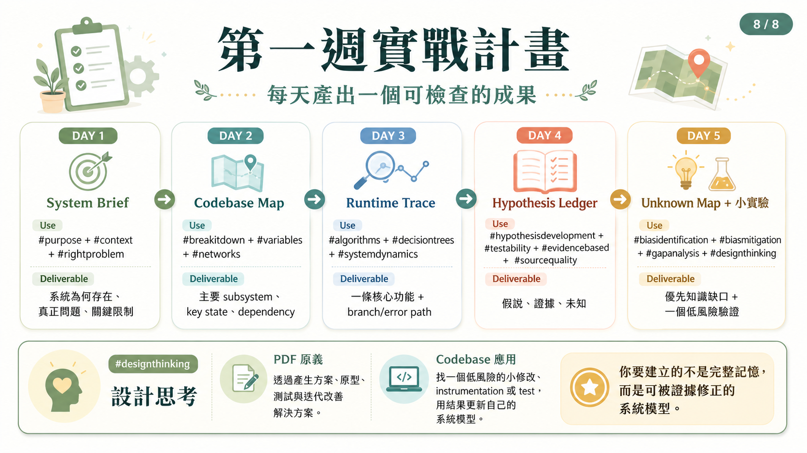
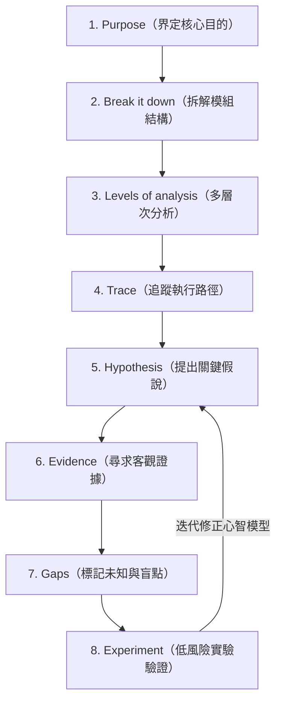

# [筆記] 用密涅瓦大學（Minerva）核心習慣與通識能力（HCs）讀懂陌生 Codebase

面對龐大且陌生的 Codebase，最忌諱過早陷入局部細節或盲目通讀原始碼。本文將密涅瓦大學（Minerva）的核心習慣與通識能力（HCs）轉化為一套專門探索陌生 Codebase 的認知工具箱，透過多層次拆解、假說驗證與系統動力學思維，建立清晰且精確的心智模型（Mental Model）。
<!--more-->

參考連結：https://www.mext.go.jp/content/20250717-mxt_koutou02-000043727_4.pdf

---

## 什麼是核心習慣與通識能力（HCs）？

**HCs（Habits of Mind and Foundational Concepts）** 是密涅瓦大學教學架構的核心，其定義與在工程領域的定位如下：

- **本質** ：面對高度複雜與未知問題時，可反覆調用的 **思考習慣與認知標籤** （非死記硬背的知識點，亦非死板僵化的 80 步 Checklist）。
- **在工程上的定位** ：閱讀陌生系統時，用來「提醒自己如何思考、避免過早下定論」的認知導航工具。
- **核心心態** ：不追求「一次看完整個 codebase」，而是專注於 **「透過證據逐步建立並修正系統運作的 Mental Model」** 。

---

## 各階段 HC 拆解與實踐

在進入大型 C 專案時，可將認知歷程分為六個階段，各階段對應特定的 HCs 思考工具與具體工程產出：
1. **階段一：界定問題** （產出：System Brief）
2. **階段二：結構拆解** （產出：Codebase Map）
3. **階段三：多層次理解** （系統動力學）
4. **階段四：追蹤執行路徑** （產出：Happy Path & Error Path）
5. **階段五：假說驗證** （產出：Hypothesis Ledger）
6. **階段六：盲點管理** （產出：Unknown Map）

### 階段一：界定問題（產出：System Brief）

在閱讀任何一行具體函式之前，先釐清「這套系統為何存在、需要先掌握什麼外部條件」：

- `#purpose`（核心目的）：釐清這套系統的使用者是誰、解決什麼核心問題、主要的輸入／輸出為何，以及成功運作的標準。
- `#context`（脈絡）：補足非程式碼的背景資訊，包含底層硬體架構、通訊協定（Protocol）、作業系統限制、歷史技術包袱與效能邊界。
- `#rightproblem`（找對問題）：優先鎖定當前最迫切需要理解的核心路徑與問題，避免過早鑽入旁枝末節的實作細節。

### 階段二：結構拆解（產出：Codebase Map）

將看似密不可分的龐大系統分解為可獨立理解的模組與其相互關係：

- `#breakitdown`（問題拆解）：自頂向下依序拆解： **大系統 $\to$ Subsystem $\to$ Module $\to$ 模組職責** 。
- `#variables`（變數與狀態）：找出關鍵的 State、Configuration、核心 Struct、全域變數（Global）與靜態變數（Static），並徹底釐清其讀寫權限與生命週期（Ownership）。
- `#networks`（關係網絡）：繪製模組依賴圖，找出資料流向與整個系統的核心 Hub 模組。

### 階段三：多層次理解（系統動力學）

跳脫單一函式逐行追蹤的侷限，從整體系統架構的高層次切入：

- `#levelsofanalysis`（分析層次）：切換至最適當的抽象層級（ **System $\to$ Subsystem $\to$ Module $\to$ Function $\to$ State** ）進行切入分析，且此層次劃分可依專案特性彈性調整， **非固定死板層級** 。
- `#multiplecauses`（多重因果）：在 C 語言中，Bug 往往源於系統 Configuration、時序（Timing）、狀態轉移（State）與硬體行為的交互作用，絕非單純特定單一 Function 寫錯。
- `#systemdynamics`（系統動力學）：針對 Embedded 與 Pure C 的特性，深入分析 State Machine、Timer、Event 驅動與反饋迴路（Feedback Loops）等隨時間推移的動態變化行為。

### 階段四：追蹤執行路徑（產出：Happy Path & Error Path）

動態追蹤系統關鍵業務邏輯的實際運作流向：

- `#algorithms`（演算法式策略）：完整梳理從 **Input $\to$ Parse $\to$ Validate $\to$ State Transition $\to$ Action $\to$ Output** 的端到端處理邏輯。
- `#decisiontrees`（決策樹）：將程式碼中密集的條件判斷（`if/else`、`switch`）抽象化為包含分支（Branch）、前置條件（Condition）與異常處理（Error Handling）的完整決策模型。

### 階段五：假說驗證（產出：Hypothesis Ledger）

工程師最常見的盲點是「以為自己看懂了」。此階段將主觀猜測具體轉化為「可檢驗的命題」：

- `#hypothesisdevelopment`（假說發展）：將推測具體化（例如：「推測 Connection state 是由 Module A 負責管理」）。
- `#testability`（可檢驗性）：為假說設計明確的驗證途徑（例如：查看 Log、設定斷點、於 Runtime 觀察行為、執行特定 Unit Test）。
- `#evidencebased`（證據導向）：必須使用實際程式碼、測試結果或執行數據佐證，杜絕主觀臆測。
- `#sourcequality`（來源品質）：客觀評估證據的可信度排序： **Runtime 行為 $\ge$ Test $\ge$ Implementation $\ge$ Spec 文件 $\ge$ 口頭傳聞** 。

#### Hypothesis Ledger 結構範例

透過結構化表格記錄並持續更新假說狀態：

| Claim（主張） | Evidence（證據） | Confidence（信心度） | Status（狀態） |
| :--- | :--- | :--- | :--- |
| Connection state 由 Module A 管理 | Code 實作 + 單元測試覆蓋 | High | **已確認** |
| Retry 機制由 Module B 觸發 | 靜態程式碼分析 | Medium | **待驗證假說** |
| 連線 Timeout 之根本原因 | 尚無直接日誌與測試證據 | Low | **Unknown** |

### 階段六：盲點管理（產出：Unknown Map）

主動辨識知識斷層與既有的思維偏誤，避免帶入錯誤假設：

- `#biasidentification`（偏誤辨識）：警惕跨語言或跨架構的心智模型慣性（例如：習慣性將 C++ 的物件導向與多型思維直接套用至 Pure C）。
- `#biasmitigation`（偏誤緩解）：透過刻意尋找反例、翻閱歷史 Git Commit 紀錄、撰寫對比測試等具體方式降低認知偏差。
- `#gapanalysis`（缺口分析）：條列出「已知資訊」與「達成目標所需資訊」之間的落差，標註優先順序，建立系統化的 **Unknown Map** 。

---

## 第一週實戰計畫（5-Day Roadmap）

面對一套全新的陌生專案，可以依照五天節奏循序推進，每天鎖定特定的核心思維與交付成果：

| 天數 | 目標主題 | 核心 HCs 工具 | 核心產出 |
| :--- | :--- | :--- | :--- |
| **Day 1** | **系統界定** | `#purpose` `#context` `#rightproblem` | **System Brief**  （釐清核心目的、邊界與背景限制） |
| **Day 2** | **架構拆解** | `#breakitdown` `#variables` `#networks` | **Codebase Map**  （模組邊界、關鍵狀態與相依拓撲圖） |
| **Day 3** | **動態追蹤** | `#algorithms` `#decisiontrees` `#systemdynamics` | **Execution Trace**  （正常路徑與異常路徑的執行模型） |
| **Day 4** | **假說驗證** | `#hypothesisdevelopment` `#testability` `#evidencebased` `#sourcequality` | **Hypothesis Ledger**  （嚴格區分客觀事實與主觀假設） |
| **Day 5** | **缺口與實驗** | `#biasidentification` `#biasmitigation` `#gapanalysis` `#designthinking` | **Unknown Map**  （低風險實驗驗證並迭代修正模型） |

---

## 核心心智模型流程

探索大型陌生專案不要漫無目的的隨機瀏覽，而是一個嚴謹遞進的閉環認知歷程：

$$\text{Purpose} \to \text{Break it down} \to \text{Levels of analysis} \to \text{Trace} \to \text{Hypothesis} \to \text{Evidence} \to \text{Gaps} \to \text{Experiment}$$

---

## 總結

閱讀龐大陌生的 Pure C 專案時，切忌將 HCs 當成死板填寫的清單。將它們視為一組具備彈性的 **「認知鷹架」** ，能幫助工程師在資訊過載與細節洪流中，保持高維度的全局視野， **透過實證逐步建立、驗證並動態修正對系統的心智模型** 。

---

## 我的連結
- Youtube: https://www.youtube.com/@Daydream-Studio/videos
- Podcast: https://cl4bfh8ww02uu01zgaj2i3d1u.firstory.cc/episodes
- FaceBook: https://www.facebook.com/profile.php?id=100082389794254
- Blog: https://nostanduptalk.github.io/

