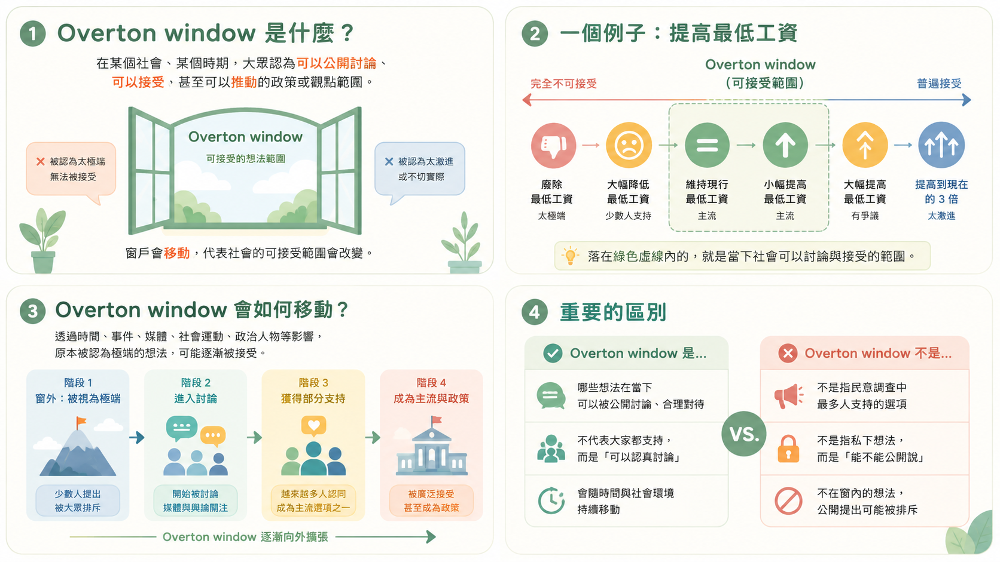

# [筆記] 奧弗頓之窗 (Overton Window) - 拓展溝通與接受範圍的思維模型

在日常溝通或推動組織變革時，你是否曾遇過滿懷熱忱提出的好點子，卻立刻被團隊或主管認為「太激進」、「不可行」而碰壁？很多時候，阻力並非來自方案本身的優劣，而是該想法落在了對方的認知接受範圍之外。這正是政治學與傳播學中經典的思維模型 —— **奧弗頓之窗（Overton Window）** 所揭示的核心本質。
<!--more-->

## 什麼是奧弗頓之窗？

**奧弗頓之窗（Overton Window）** 原本是用來描述在政治領域中，公眾或選民在特定時期內能夠接受、公開討論的政策想法範圍。在任何時刻，社會上能夠被視為合理且可討論的概念都是有限的，而這個「窗口」會隨著時代變遷、環境變化與集體認知而持續移動。

> **核心概念** ：社會或群體能接受、公開討論的觀點範圍，會隨時間與環境改變。

---

## 1. 核心知識：窗內與窗外的光譜

奧弗頓之窗將觀點劃分為不同區間：

- **窗內（In the Window）** ：被大眾或決策者認為是合理、正常且值得公開討論的觀點。
- **窗外（Outside the Window）** ：被認為過於極端、荒謬或目前難以接受的想法。
- **窗口的動態移動** ：原本被視為天方夜譚或離經叛道的觀點，隨著時間演進可能逐步進入討論，甚至成為主流常態。
- **重要區別** ： **「可以被公開討論」不等於「多數人都支持」** 。進入窗口只是拿到對話與評估的入場券，而非直接拍板定案。

---

## 2. 核心運作機制：從極端走向主流的演進路徑

觀點進入大眾視野通常遵循一個漸進的歷程：

> **窗外（極端想法） ➡️ 進入公開討論 ➡️ 逐漸被大眾接受 ➡️ 成為具體政策選項**

### 推進窗口移動的關鍵因素
1. **媒體傳播與議題設定** ：透過持續報導與討論，降低群眾對陌生概念的心理排斥。
2. **社會運動與倡議** ：藉由標竿事件或先鋒倡導，引發公眾反思既有框架。
3. **重大外部事件** ：外在危機（例如經濟衝擊、技術突破或公衛事件）常會瞬間打破既有常規，加速窗口劇烈位移。

> **注意** ：這是一條簡化理解的路徑模型，並不代表所有議題都會按照固定順序單向發展，窗口也可能因社會保守氛圍而向後收縮。

---

## 3. 經典案例：最低工資政策的變遷

以 **「大幅提高最低工資」** 政策為例：
在過去自由市場至上的背景下，提出倍增最低基本工資的訴求，很容易被經濟學者與政策制定者視為激進且會破壞市場機制的極端主張（位於窗外）。

然而，隨著生活成本高漲、貧富差距擴大以及勞工團體持續提出倡議與論證，這個議題逐漸走入國會與大眾媒體的視野（進入討論）。隨著公眾認知轉變與試點研究出爐，大幅調高最低工資不再是不可碰觸的禁忌，最終逐步成為可被政府認真評估並採納的正式政策（成為政策選項）。

---

## 4. 工作應用：在職場中如何拓展對方的接受之窗

**適用情境** ：策略提案、組織變革、產品創新、跨部門溝通與向上管理。

當你想在團隊中導入全新工具或大幅重整現有流程時，不要期待對方一步到位：

1. **判斷現況（評估窗口位置）** 
   - 仔細觀察目前的文化與認知：我的提案到底處於對方的「窗內」還是「窗外」？
   - 若對方的認知尚未就位，強行端出全套變革只會引來劇烈反彈。
2. **調整切入點（由微小改變破冰）** 
   - 若完整提案過於超前，不妨退回窗內邊緣，先從 **「阻力最小、最容易被接受的小改變」** 開始著手。
3. **擴大接受度（持續拓展對方的認知邊界）** 
   - 善用同行案例、數據佐證、小規模試點（Pilot）與持續溝通，逐步降低新方案的未知與恐懼感。
4. **掌握時機（伺機推動大幅方案）** 
   - 當外部環境出現變化（例如競品威脅、組織瓶頸）或團隊認知逐漸轉變時，順勢將奧弗頓之窗向目標推進，此時推動大幅變革往往事半功倍。

---

## 5. 記憶與實戰補充

> **記憶口訣** ： **先進入討論，再爭取認同，最後推動改變。**

工作上遇到提案阻力時，不一定要急著在當下說服所有人。更成熟的做法是： **先精準判斷對方的接受範圍，再設計一套漸進式的溝通節奏與驗證策略。**

### 關鍵提醒
- **改變奧弗頓之窗不等於操控輿論** ：其核心在於建立理解與共識，而非單純的話術操弄。
- **維度拆解** ：評估議題時，應將 **「討論度」** 、 **「支持度」** 與 **「執行可行性」** 三者分開衡量。
- **實戰重點** ：溝通的本質不僅僅是優化自己的提案內容，更是去 **理解、尊重並有策略地拓展對方的接受範圍** 。

---

## 我的連結
- Youtube: https://www.youtube.com/@Daydream-Studio/videos
- Podcast: https://cl4bfh8ww02uu01zgaj2i3d1u.firstory.cc/episodes
- FaceBook: https://www.facebook.com/profile.php?id=100082389794254
- Blog: https://nostanduptalk.github.io/

