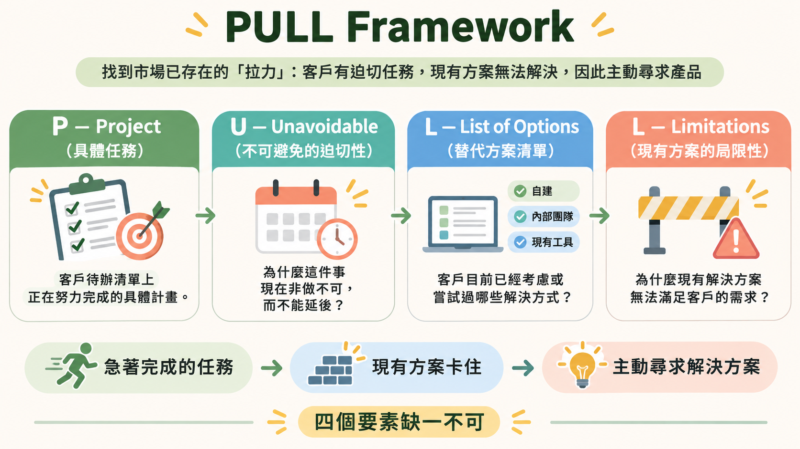

# [筆記] 顛覆 PMF 傳統迷思：打造爆款產品的「拉力法則」與 3 個心法


傳統的 PMF 理論常強調「解決客戶痛點」，但現實是「有痛點不代表客戶會買單」。真正的 PMF（Product-Market Fit）不是靠說服客戶的 Push（推力），而是來自市場中本就存在的 Pull（拉力）。本文深入解析 PULL Framework 的四大要素，協助創業者與產品經理避開假性需求陷阱，打造真正讓市場主動搶購的產品。
<!--more-->

原文連結：https://www.youtube.com/watch?v=19qrLchbQEc

---

## 一、核心觀念：PMF 來自 Pull，而非 Push

傳統 PMF 強調尋找痛點、提供差異化價值，但 **有痛點不代表客戶會優先購買** 。

真正的 PMF 來自市場中已存在的 **「拉力（Pull）」** ：

- **Push（推力）** ： 努力說服客戶產品有價值、值得嘗試。
- **Pull（拉力）** ： 客戶手上有迫切進行的任務，現有方案完全無法解決，因此主動尋求產品解法。

> 客戶不是因為產品本身很有價值而購買，而是因為有重要任務急著完成，卻被現有方案卡住。

**關鍵思維** ： **Pull 存在於具體個人的優先事項，而非抽象的公司需求** 。

---

## 二、PULL Framework：找到市場已存在的需求



PULL 架構由四個不可或缺的要素組成：

### 1. P — Project（具體任務）

客戶待辦清單上正在努力完成的具體計畫與目標。

- 不是「想購買招募軟體」。
- 而是「現在需要招募更多關鍵工程師」。

**驗證問題** ： 你現在急著完成什麼任務？

### 2. U — Unavoidable（不可避免的迫切性）

客戶為什麼現在非做不可，而不能往後延期？

**驗證問題** ： 為什麼這件事現在一定要完成？

### 3. L — List of Options（替代方案清單）

客戶目前已經考慮或嘗試過哪些解決方式？

常見替代方案包含：

- 自己手動處理。
- 交由內部現有團隊硬撐完成。
- 使用市場上現有的工具或通用軟體。

**驗證問題** ： 你目前有哪些解決方案或替代工具？

### 4. L — Limitations（現有方案的局限性）

為什麼上述現有的解決方案無法滿足客戶需求？

**驗證問題** ： 為什麼這些既有方案仍然無法根本解決問題？

### PULL 的關鍵聯立條件

**Project + Unavoidable + List of Options + Limitations 四個要素缺一不可。**

當客戶有急著完成的任務，卻被現有方案卡住，就會形成 **「緊繃的彈簧（Coiled Spring）」** 。此時只要市場上出現能解除僵局的產品，客戶就會主動尋求合作。

### 案例對比：Jump AI 理財顧問筆記工具

- **理財顧問（具有強烈 Pull）** ：
  - **P — Project** ： 減少客戶會議後手動整理筆記與輸入 CRM 的時間。
  - **U — Unavoidable** ： 必須嚴格遵守 SEC（美國證券交易委員會）相關法規與合規要求。
  - **L — List of Options** ： 一般通用型 AI 會議筆記工具。
  - **L — Limitations** ： 缺乏理財顧問專屬 CRM 整合與合規留存審核能力。
- **保險經紀人（缺乏 Pull）** ：
  - 雖然同樣希望減少會議筆記時間（Project），但缺乏法規強制記錄的迫切性（Unavoidable）。
  - 現有的替代方案（List of Options），例如不寫或草草記錄，對他們而言已經足夠好，因此不存在必須突破的局限性（Limitations）。

> **記憶重點** ： **有痛點 ≠ 有迫切性 ≠ 有購買動機** 。

---

## 三、產品開發：先驗證 Pull，再打造 MVP

### 1. 用兩頁簡報驗證 Pull Hypothesis（拉力假設）

在投入任何程式開發前，先建立清晰的 PULL Hypothesis，並製作兩頁簡報向潛在客戶驗證：

- **第一頁：描述客戶的 PULL**
  - **Project** ： 你目前正在完成什麼具體任務？
  - **Unavoidable** ： 為什麼這件事現在必須完成？
  - **List of Options** ： 你先前考慮過哪些替代方案？
  - **Limitations** ： 為什麼現有方案無法滿足需求？
  - *最後確認* ：「我理解得正確嗎？」
- **第二頁：提出概念性解決方案**
  - 展示如何更快、更低成本、更少阻力地協助客戶完成該任務。
  - *最後確認* ：「這樣的方式符合你的期待嗎？」

### 2. 辨識真正的市場訊號

- **真正的 Pull 訊號** ：
  - 客戶主動追問：「我們該如何開始合作？」
  - 急著詢問產品何時可以上線使用。
  - 積極主動討論合約與預算流程。
  - 想立即推進下一步進度。
- **假性熱情（無 Pull）** ：
  - 口頭稱讚：「這產品非常有前景！」
  - 評估說：「這可能幫公司省下很多成本。」
  - 拖延回應：「請寄一份簡報給我們團隊內部評估。」
  - 表態：「我們下個季度再找時間聊聊。」

> **觀察原則** ： **觀察客戶是否主動推進行動，而不是聽他口頭如何稱讚產品** 。

### 3. 避免 Design Partners（設計夥伴）陷阱

早期設計夥伴可能提供大量產品功能反饋，卻往往沒有實質付費意願：

- 願意提供意見，不代表願意買單。
- 持續試用產品，不代表產品達成 PMF。
- 真正有迫切任務的客戶，唯一目標是儘速解除卡關、完成工作。

**重點提醒** ： **切勿把產品回饋與使用活躍度，誤認為真正的市場拉力** 。

### 4. Service-Shaped MVP（服務型 MVP）

**先交付成果，再決定如何產品化。**

不必一開始就急於打造完整的 SaaS 平台架構，而是先以「人工程式混合服務」形式替客戶解決任務。

**運作方式** ：

1. 對外提供能保證完成特定成果的專案服務。
2. 幕後結合人工、AI 提示詞與簡易腳本混合交付。
3. 在真實交付過程中，觀察客戶最在乎的交付細節與瓶頸。
4. 最終才決定哪些高頻環節值得用正式程式碼自動化。

**三個主要目的** ：

- **驗證真實 Pull** ： 確認客戶是否急著要成果，以及是否願意真實掏錢交易。
- **管理客戶期待** ： 讓客戶聚焦於任務成果，而非挑剔尚未成熟的介面或系統功能。
- **確認自動化規格** ： 從實務交付的痛點中，找到真正值得花資源產品化的核心功能。

> **核心價值** ： **客戶要的是問題被解決的成果，而不是成熟複雜的軟體架構** 。

---

## 四、早期銷售：Selling to Learn（透過銷售來學習）

### 1. Founder Magic Outreach（創始人魔法外展）

冷陌生接觸（Outreach）的目的不是直接推銷產品，而是透過創始人的真實個人特質引起好奇，開啟雙向對話。

- **核心原則** ：
  - 訊息極度精簡，約 `1～2` 句以內。
  - 展現創始人的真實經歷、專長或獨特見解。
  - 避免制式、冰冷的範本與 AI 推銷感。
  - 不必過度刻意包裝複雜客製化內容。
  - 以引發好奇心、促成深度會談為唯一目標。

### 2. 30 分鐘 Sales Call（探索式銷售通話）

- **第一步：了解客戶為何願意撥空開會**
  - 開場直接請教：
    > 「每天應該有很多人寄信找你，今天為什麼願意跟我開會？」
  - 讓客戶親口說出目前內心真正卡住的 PULL。
- **第二步：贏得深入提問的權利（Earn the Right to Ask Discovery Questions）**
  - 根據對方回覆，進一步詢問：
    > 「介意我先請教幾個問題，好更深入了解你們的現況嗎？」
  - 取得明確許可後，逐一深入探索 **PULL** 四要素：
    - **Project** ： 目前最急迫的具體目標。
    - **Unavoidable** ： 為什麼非得在近期內搞定。
    - **List of Options** ： 過去嘗試過哪些手段。
    - **Limitations** ： 為什麼這些手段依然無法過關。

> **核心心態** ： **Selling to Learn（銷售是為了深度學習市場），而不是 Selling to Push（強推產品）** 。

### 3. 早期定價：Willingness to Transact（交易意願）

早期的定價目標不是追求極致利潤，而是驗證客戶是否具備真實的 **「交易意願」** 。

**Pricing Talk Track（定價錨定話術）** ：

利用過往合作的價格範圍進行錨定，而非直接丟出單一死板報價。

> 「我們有些輕量型專案大約是 8 萬美元，有些規模較大的全面部署會到 100 萬美元，多數專案落在兩者中間。你會怎麼評估我們這次的合作範圍？」

**話術效益** ：

- 快速測試客戶對於解決問題的預算級距與交易誠意。
- 避免單一價格過高直接嚇跑客戶，或過低低估自身價值。
- 建立對等協商基礎，雙方共同定義專案範疇與合理預算。

---

## 五、三個核心心法（Mindsets）

### 1. Pull 屬於具體個人，不屬於抽象公司

不要籠統地尋找「某某產業或某某公司」需要什麼產品。必須鎖定 **具體職務的角色，正在執行什麼個人無法獨力完成的優先任務** 。

- ❌ 錯誤切入：把產品賣給 SpaceX。
- ✅ 正確切入：找到 SpaceX 的法務主管，她正急著在期限內處理一項合規審查，卻被既有工具卡死。

### 2. Pull 是被發現的，不是被創造的

市場拉力早在產品誕生前就已客觀存在。創業者與 PM 應從「發明家思維」轉為 **「尋寶者思維」** ：

- 不是花費無窮力氣去教育、說服客戶相信問題存在。
- 而是主動搜尋市場上已經火燒屁股、卻找不到趁手工具的人。

> **心法重點** ： **不要試圖替客戶創造迫切性，而是去發現市場中既有的迫切性** 。

### 3. PULL 四個要素必須同時成立

在評估每一次客戶機會時，持續檢視四項條件：

- **P — Project** ： 任務是否真的存在且屬高優先級？
- **U — Unavoidable** ： 是否有不能拖延的明確時間壓力？
- **L — List of Options** ： 客戶是否已在尋找或評估替代手段？
- **L — Limitations** ： 現有替代手段是否確實無法接受？

> 當發現 **Unavoidable 不足** （客戶不急）或 **Limitations 不足** （現狀尚可接受）時，千萬不要強行推銷，應果斷調整 Pull Hypothesis。

---

## 六、工作應用：PMF 驗證 SOP

- **Step 1：鎖定具體客戶角色** ： 找到組織內真正扛責任的任務負責人。
- **Step 2：建立 PULL Hypothesis** ： 具體寫下 Project、Unavoidable、List of Options 與 Limitations。
- **Step 3：透過兩頁簡報驗證** ： 第一頁核對拉力現實，第二頁展示概念解法。
- **Step 4：觀察真實拉力訊號** ： 檢視客戶是否主動追問期程、積極爭取內部進度。
- **Step 5：提供 Service-Shaped MVP** ： 以半人工混合交付，快速解決核心卡點。
- **Step 6：驗證 Willingness to Transact** ： 確認客戶有實質付費意願，完成真實交易。
- **Step 7：根據真實交付決定產品化** ： 僅對反覆驗證的高價值關鍵瓶頸投入軟體自動化。

---

## 七、PULL 訪談紀錄模板

```markdown
### 客戶基本資訊
- 公司：
- 職務：
- 受訪者：

### P — Project（具體任務）
- 客戶目前急著完成什麼具體目標？
- 這個任務是否位列他本月／本季的最高優先事項？

### U — Unavoidable（不可避免的迫切性）
- 為什麼現在非完成不可？
- 如果這件事往後延宕一至兩個月，會引發什麼嚴重後果？

### L — List of Options（替代方案清單）
- 客戶目前採取什麼方式應對？
- 過去曾評估或使用過哪些同類工具？

### L — Limitations（現有方案的局限性）
- 現有作法遭遇哪些關鍵瓶頸？
- 為什麼這些限制使任務無法如期達標？

### 市場拉力（Pull）檢驗
- 客戶是否主動詢問如何開始？
- 客戶是否積極排定下一次討論時程？
- 客戶是否表現出明確的實質交易意願？
```

---

## 八、最後記住

> **不要先打造了產品，才到處尋找需要它的人。**
>
> **先找到急著完成任務、卻被現有方案卡住的人，再傾力協助他完成任務。**

PMF 的精髓不是產品獲得了多少客套讚賞，而是市場中是否存在源源不絕的真實 Pull。

$$\text{PULL} = \text{Project} + \text{Unavoidable} + \text{List of Options} + \text{Limitations}$$

當四個條件同時具備，產品就不需要費力推銷，市場自然會主動拉動你的成長。

**核心路徑** ： **發現既有 Pull** ➔ **驗證 Pull 假設** ➔ **Service-Shaped MVP 交付** ➔ **驗證交易意願** ➔ **軟體產品化** 。

---

## 我的連結
- Youtube: https://www.youtube.com/@Daydream-Studio/videos
- Podcast: https://cl4bfh8ww02uu01zgaj2i3d1u.firstory.cc/episodes
- FaceBook: https://www.facebook.com/profile.php?id=100082389794254
- Blog: https://nostanduptalk.github.io/

